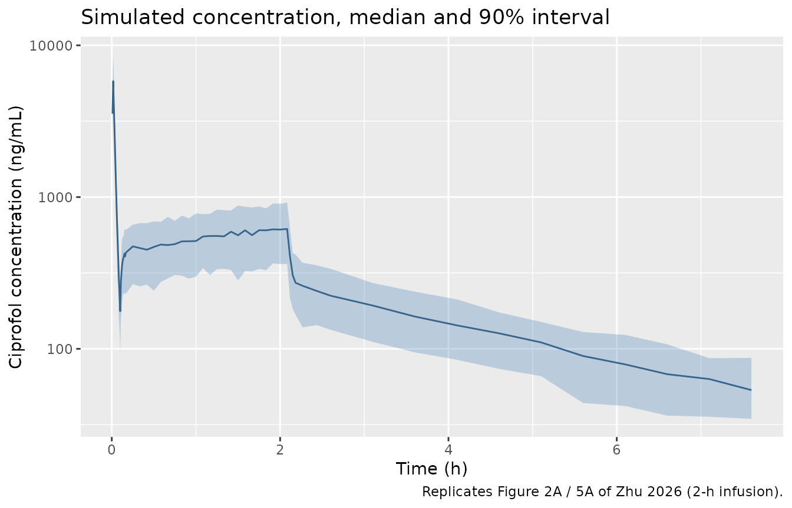
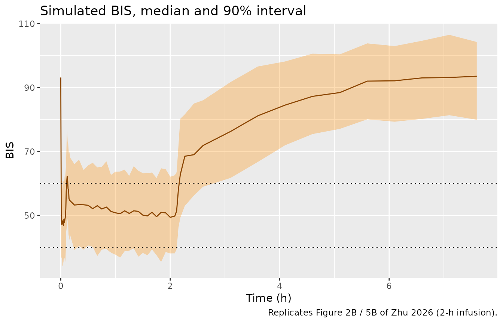
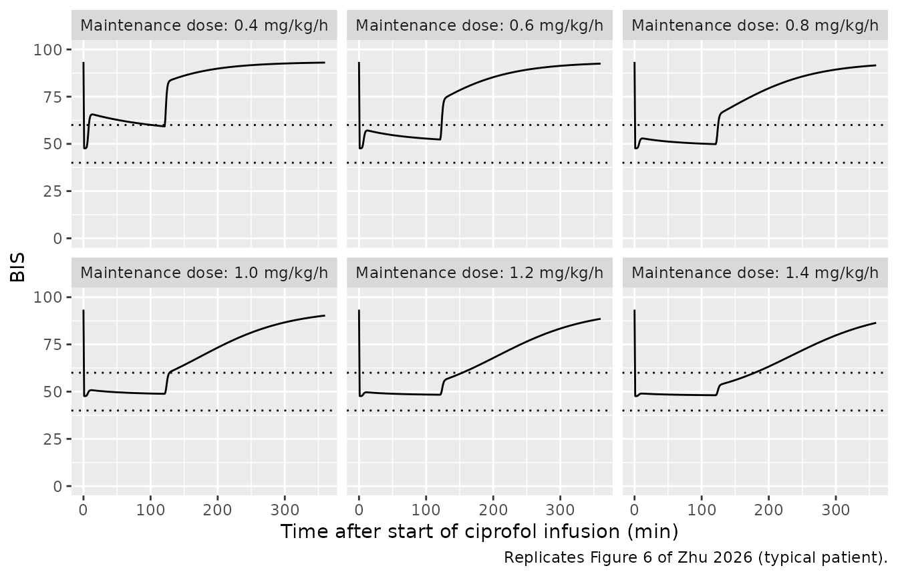
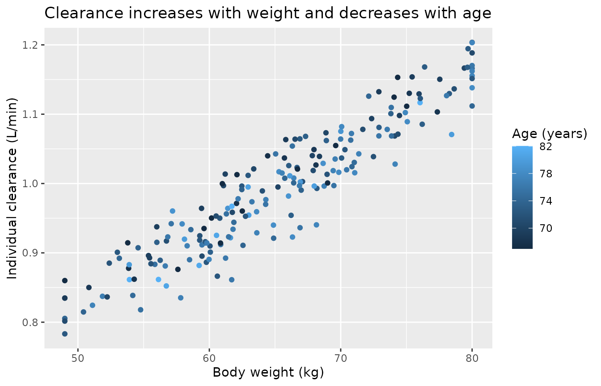

# Ciprofol (Zhu 2026)

## Model and source

- Citation: Zhu J, He J, Zhong B, Cao Y, Zhang X, Xu B. From
  pharmacokinetics to precision dosing: optimizing continuous infusion
  regimens of ciprofol for elderly patients. Front Pharmacol.
  2026;17:1764590. <doi:10.3389/fphar.2026.1764590>. PMID: 41704278.
  PMCID: PMC12907304. Chinese Clinical Trial Registry ChiCTR2400093796.
- Description: Population PK/PD model for ciprofol (HSK3486) and the
  bispectral index (BIS) in elderly (\>= 65 years) Chinese surgical
  patients receiving a 0.4 mg/kg intravenous loading dose followed by a
  continuous infusion (Zhu 2026; 20 patients, 386 arterial plasma
  samples with time-matched BIS). PK is a three-compartment model with
  first-order elimination from the central compartment; clearance
  carries power covariate effects of body weight (exponent 0.74, centred
  on 66 kg) and age (exponent -0.21, centred on 72.5 years). PD is an
  effect-compartment (ke0) link to an inhibitory sigmoid Imax model on
  BIS with no covariates. Log-normal inter-individual variability on all
  six PK disposition parameters and on IC50 and the Hill coefficient;
  proportional residual error on concentration and additive residual
  error on BIS.
- Article: <https://doi.org/10.3389/fphar.2026.1764590>

Zhu 2026 developed a population PK/PD model for ciprofol (HSK3486), a
propofol analogue, in elderly surgical patients and used it to choose a
maintenance infusion rate for general anaesthesia. The model has two
linked parts (Figure 1):

1.  a **three-compartment** disposition model for ciprofol with
    intravenous input into the central compartment and first-order
    elimination, with body weight and age as power covariates on
    clearance;
2.  an **effect compartment** equilibrating with the plasma
    concentration at rate `ke0`, driving an **inhibitory sigmoid Imax**
    model on the bispectral index (BIS).

The PK and PD parameters are reported in two tables (Table 2 and Table
3) but describe one PK/PD structure, so they are packaged as a single
model file.

## Population

Twenty elderly patients (11 men, 9 women; age 67-82 years, median 72.5;
weight 49-80 kg, median 66) undergoing elective orthopaedic, general,
urological or thoracic surgery at a single centre in China between
December 2024 and May 2025 were enrolled (Table 1). Three quarters were
ASA physical status II and one quarter ASA III. Each received ciprofol
0.4 mg/kg as a 1-min intravenous bolus for induction, then a 0.8 mg/kg/h
continuous infusion starting 5 min later and stopped when skin suturing
began. Remifentanil was given to every patient by effect-site
target-controlled infusion; midazolam was added in 3 patients when BIS
exceeded 60 (Supplementary Table S3).

The dataset comprised 386 arterial plasma ciprofol concentrations
(UPLC-MS/MS, LLOQ 5 ng/mL) and 386 time-matched BIS readings. Age,
weight, sex, height, BMI and liver and renal laboratory values were
screened as covariates; only weight and age on clearance were retained.

The same information is available programmatically via
`readModelDb("Zhu_2026_ciprofol")()$population`.

## Source trace

Every `ini()` entry in `inst/modeldb/specificDrugs/Zhu_2026_ciprofol.R`
carries an in-file comment pointing at its source location. They are
collected here for review.

| Equation / parameter | Value | Source location |
|----|----|----|
| `lcl` (CL) | 1.01 L/min | Table 2, final model (RSE 7.23%) |
| `lvc` (V1) | 2.95 L | Table 2 (RSE 8.54%) |
| `lvp` (V2, shallow) | 45.15 L | Table 2 (RSE 6.20%) |
| `lvp2` (V3, deep) | 76.79 L | Table 2 (RSE 5.15%) |
| `lq` (Q2) | 0.76 L/min | Table 2 (RSE 6.83%) |
| `lq2` (Q3) | 0.66 L/min | Table 2 (RSE 3.84%) |
| `e_wt_cl` | 0.74 | Table 2, ‘WT on CL’ (RSE 12.42%) |
| `e_age_cl` | -0.21 | Table 2, ‘Age on CL’ (RSE 8.63%) |
| Reference WT / AGE | 66 kg / 72.5 years | Results, final clearance equation; Table 1 medians |
| `lke0` (Ke0) | 1.09 1/min | Table 3 (RSE 25.20%) |
| `lrbase` (E0) | 93.40 | Table 3 (RSE 0.71%) |
| `limax` (Imax) | 45.77 | Table 3 (RSE 3.83%) |
| `lec50` (IC50) | 233.91 ng/mL | Table 3 (RSE 8.06%) |
| `lhill` (gamma) | 3.00 | Table 3 (RSE 12.92%) |
| `etalvc` / `etalvp` / `etalvp2` | omega 0.06 / 0.11 / 0.11 | Table 2, BSV block |
| `etalcl` / `etalq` / `etalq2` | omega 0.03 / 0.03 / 0.02 | Table 2, BSV block |
| `etalec50` / `etalhill` | omega 0.09 / 0.02 | Table 3, BSV block |
| `etalke0` / `etalrbase` / `etalimax` | fixed 0 | Table 3 shrinkage column (omega not reported; see below) |
| `propSd` | 0.26 | Table 2, sigma |
| `addSd_BIS` | 7.70 | Table 3, sigma |
| Exponential IIV, eta ~ N(0, omega^2) | n/a | Methods, ‘Construction of the PK model’ |
| Proportional RUV | n/a | Methods; Supplementary Table S2 |
| Clearance covariate model | n/a | Results, ‘Population PK model’ |
| Effect compartment, dCe/dt = ke0 (C1 - Ce) | n/a | Methods, ‘Construction of the population PD model’ |
| Sigmoid Imax on BIS | n/a | Methods, ‘Construction of the population PD model’ |
| Compartment topology | n/a | Figure 1 |

## Virtual cohort

Individual data are not public. The virtual cohort draws weight and age
from normal distributions matching Table 1 (weight 65.63 +/- 9.34 kg,
age 72.95 +/- 4.47 years), truncated to the observed ranges. Dosing
follows the study protocol: 0.4 mg/kg over 1 min, then 0.8 mg/kg/h from
6 min. The infusion ran until skin suturing began, which differed by
patient (Figure 2 shows infusions of roughly 1 to 4 h); a 2-h infusion
is used here, matching the duration of the paper’s own dosing
simulations.

``` r

set.seed(20260212)
n_sub <- 200L

trunc_norm <- function(n, mean, sd, lo, hi) pmin(pmax(rnorm(n, mean, sd), lo), hi)

subj <- tibble(
  id        = seq_len(n_sub),
  WT        = trunc_norm(n_sub, 65.63, 9.34, 49, 80),
  AGE       = trunc_norm(n_sub, 72.95, 4.47, 67, 82),
  treatment = "0.4 mg/kg + 0.8 mg/kg/h for 2 h"
)

inf_start <- 6
inf_end   <- inf_start + 120

obs_times <- sort(unique(c(
  seq(0, 10, by = 0.5), seq(10, inf_end, by = 5),
  inf_end + c(1, 3, 5, 10, 20, 30), seq(inf_end + 60, inf_end + 360, by = 30),
  seq(inf_end + 420, 1440, by = 60)
)))

doses <- bind_rows(
  subj |> mutate(time = 0, amt = 0.4 * WT, rate = 0.4 * WT),
  subj |> mutate(time = inf_start, amt = 0.8 * WT * 2, rate = 0.8 * WT / 60)
) |>
  mutate(evid = 1L, cmt = "central", dvid = NA_integer_)

# Two endpoints (Cc and BIS) are declared, so observation rows name the ODE
# state and carry dvid = 1; rxode2 returns both endpoints as columns.
obs <- tidyr::crossing(subj, time = obs_times) |>
  mutate(amt = NA_real_, rate = NA_real_, evid = 0L, cmt = "central", dvid = 1L)

events <- bind_rows(doses, obs) |> arrange(id, time, desc(evid))
stopifnot(length(unique(events$id)) == n_sub)
```

## Simulation

``` r

mod <- readModelDb("Zhu_2026_ciprofol")
rxode2::rxSetSeed(20260212)

sim <- rxode2::rxSolve(
  mod, events = events, useLinCmt = FALSE,
  keep = c("treatment", "WT", "AGE"), returnType = "data.frame"
)
#> ℹ parameter labels from comments will be replaced by 'label()'
#> ℹ omega/sigma items treated as zero: 'etalke0', 'etalrbase', 'etalimax'

stopifnot(
  identical(rxode2::rxode(mod)$state, c("central", "peripheral1", "peripheral2", "effect")),
  max(sim$peripheral2, na.rm = TRUE) > 0
)
#> ℹ parameter labels from comments will be replaced by 'label()'
```

## Replicate published figures

### Concentration and BIS time courses (Figures 2 and 5)

Replicates the layout of Figure 2 (observed profiles) and Figure 5
(prediction-corrected VPC) of Zhu 2026: the 5th, 50th and 95th
percentiles of simulated concentrations and BIS, including residual
error, over the first 8 h.

Residual error is added to each individual prediction with its own error
model (proportional SD 0.26 on concentration, additive SD 7.70 on BIS).

``` r

set.seed(1)
sim_obs <- sim |>
  filter(time <= 480) |>
  mutate(
    Cc_obs  = Cc * (1 + rnorm(n(), 0, 0.26)),
    BIS_obs = BIS + rnorm(n(), 0, 7.70)
  )

pct <- sim_obs |>
  group_by(time) |>
  summarise(
    Cc_lo  = quantile(Cc_obs, 0.05), Cc_md  = median(Cc_obs),  Cc_hi  = quantile(Cc_obs, 0.95),
    BIS_lo = quantile(BIS_obs, 0.05), BIS_md = median(BIS_obs), BIS_hi = quantile(BIS_obs, 0.95),
    .groups = "drop"
  )

ggplot(filter(pct, time > 0), aes(time / 60)) +
  geom_ribbon(aes(ymin = pmax(Cc_lo, 1), ymax = Cc_hi), fill = "steelblue", alpha = 0.3) +
  geom_line(aes(y = Cc_md), colour = "steelblue4") +
  scale_y_log10() +
  labs(x = "Time (h)", y = "Ciprofol concentration (ng/mL)",
       title = "Simulated concentration, median and 90% interval",
       caption = "Replicates Figure 2A / 5A of Zhu 2026 (2-h infusion).")
```



``` r


ggplot(pct, aes(time / 60)) +
  geom_ribbon(aes(ymin = BIS_lo, ymax = BIS_hi), fill = "darkorange", alpha = 0.3) +
  geom_line(aes(y = BIS_md), colour = "darkorange4") +
  geom_hline(yintercept = c(40, 60), linetype = "dotted") +
  labs(x = "Time (h)", y = "BIS",
       title = "Simulated BIS, median and 90% interval",
       caption = "Replicates Figure 2B / 5B of Zhu 2026 (2-h infusion).")
```



During the 0.8 mg/kg/h infusion the simulated median concentration sits
at roughly 500-650 ng/mL, inside the 400-800 ng/mL band of the observed
profiles in Figure 2A, and concentrations fall to about 50-100 ng/mL 4 h
after the infusion stops, as in Figure 2A.

``` r

plateau <- sim |> filter(time >= 60, time <= inf_end) |>
  summarise(med_cc = median(Cc), med_bis = median(BIS))
plateau
#>     med_cc  med_bis
#> 1 583.1112 50.43695
# Structural check against Figure 2A: a wrong unit, clearance or volume moves
# the median maintenance concentration out of the observed band by far more
# than the cohort-to-cohort noise.
stopifnot(plateau$med_cc > 400, plateau$med_cc < 800)
```

### Maintenance-rate simulations (Figure 6)

Figure 6 of Zhu 2026 shows BIS over 6 h for a 0.4 mg/kg loading dose
over 1 min followed by 2-h infusions of 0.4 to 1.4 mg/kg/h. The paper’s
curves are single lines; they are reproduced here for the typical
patient (66 kg, 72.5 years).

``` r

rates <- c(0.4, 0.6, 0.8, 1.0, 1.2, 1.4)
typ_wt <- 66

fig6_events <- bind_rows(lapply(seq_along(rates), function(i) {
  r <- rates[i]
  bind_rows(
    tibble(id = i, time = 0, amt = 0.4 * typ_wt, rate = 0.4 * typ_wt, evid = 1L),
    tibble(id = i, time = 1, amt = r * typ_wt * 2, rate = r * typ_wt / 60, evid = 1L),
    tibble(id = i, time = seq(0, 360, by = 1), amt = NA_real_, rate = NA_real_, evid = 0L)
  ) |>
    mutate(WT = typ_wt, AGE = 72.5, regimen = sprintf("Maintenance dose: %.1f mg/kg/h", r))
})) |>
  mutate(cmt = "central", dvid = ifelse(evid == 0L, 1L, NA_integer_)) |>
  arrange(id, time, desc(evid))

fig6 <- rxode2::rxSolve(
  rxode2::zeroRe(mod), events = fig6_events, useLinCmt = FALSE,
  keep = "regimen", returnType = "data.frame"
)
#> ℹ parameter labels from comments will be replaced by 'label()'
#> ℹ omega/sigma items treated as zero: 'etalvc', 'etalvp', 'etalvp2', 'etalcl', 'etalq', 'etalq2', 'etalke0', 'etalrbase', 'etalimax', 'etalec50', 'etalhill'
#> Warning: multi-subject simulation without without 'omega'

ggplot(fig6, aes(time, BIS)) +
  geom_line() +
  geom_hline(yintercept = c(40, 60), linetype = "dotted") +
  facet_wrap(~regimen) +
  coord_cartesian(ylim = c(0, 100)) +
  labs(x = "Time after start of ciprofol infusion (min)", y = "BIS",
       caption = "Replicates Figure 6 of Zhu 2026 (typical patient).")
```



``` r

fig6_tab <- fig6 |>
  filter(time >= 10, time <= 120) |>
  group_by(regimen) |>
  summarise(min_bis = min(BIS), max_bis = max(BIS), .groups = "drop") |>
  mutate(
    paper_plateau = c("~65", "~55", "~47", "~41", "~37 falling to ~30", "~30 falling to ~23")
  )

fig6_tab |>
  dplyr::rename(
    "Regimen" = regimen,
    "Simulated BIS min (10-120 min)" = min_bis,
    "Simulated BIS max (10-120 min)" = max_bis,
    "Figure 6, read by eye" = paper_plateau
  ) |>
  knitr::kable(digits = 1)
```

| Regimen | Simulated BIS min (10-120 min) | Simulated BIS max (10-120 min) | Figure 6, read by eye |
|:---|---:|---:|:---|
| Maintenance dose: 0.4 mg/kg/h | 59.3 | 65.6 | ~65 |
| Maintenance dose: 0.6 mg/kg/h | 52.3 | 57.1 | ~55 |
| Maintenance dose: 0.8 mg/kg/h | 49.9 | 52.9 | ~47 |
| Maintenance dose: 1.0 mg/kg/h | 48.9 | 50.8 | ~41 |
| Maintenance dose: 1.2 mg/kg/h | 48.4 | 49.6 | ~37 falling to ~30 |
| Maintenance dose: 1.4 mg/kg/h | 48.1 | 49.0 | ~30 falling to ~23 |

The 0.4 and 0.6 mg/kg/h panels agree closely with Figure 6 and the 0.8
mg/kg/h panel is within about 4 BIS units, and the paper’s headline
conclusion is reproduced: 0.6 mg/kg/h keeps the typical patient’s BIS
within 40-60 throughout the 2-h infusion, while 0.4 mg/kg/h lets it
drift above 60.

``` r

bis_06 <- fig6 |> filter(regimen == "Maintenance dose: 0.6 mg/kg/h", time >= 5, time <= 120)
# Deterministic typical-value solve: the paper's stated result, BIS within
# 40-60 on 0.6 mg/kg/h, is checked directly.
stopifnot(all(bis_06$BIS > 40), all(bis_06$BIS < 60))
bis_04 <- fig6 |> filter(regimen == "Maintenance dose: 0.4 mg/kg/h", time >= 20, time <= 60)
stopifnot(all(bis_04$BIS > 60))
```

The 1.0-1.4 mg/kg/h panels of Figure 6 do **not** reproduce. With the
Table 3 estimates, BIS cannot fall below E0 - Imax = 93.40 - 45.77 =
47.6 however high the concentration, so the model flattens at about 48
for every rate from 1.0 mg/kg/h upward, whereas Figure 6 shows BIS of
about 41 at 1.0 mg/kg/h and falling to about 23 at 1.4 mg/kg/h. The
Table 3 value of Imax is repeated in the Abstract and the Results
(‘45.77’), and the Discussion states that ciprofol ‘can reduce the BIS
value by approximately 46 units compared with the baseline’, so the
tabulated parameters are carried unchanged and the high-rate panels of
Figure 6 are treated as inconsistent with them; see “Assumptions and
deviations”.

``` r

stopifnot(abs(min(fig6$BIS) - (93.40 - 45.77)) < 0.5)
```

## PKNCA validation

Zhu 2026 reports no non-compartmental results, so there is no published
NCA table to compare against. PKNCA is used instead to check the model’s
clearance: for a linear model, total dose divided by AUC0-inf equals
each subject’s clearance, and the covariate equation fixes that
clearance at `1.01 * (WT/66)^0.74 * (AGE/72.5)^-0.21` L/min. The
simulated grid runs to 24 h so that the extrapolated part of AUC0-inf is
small.

``` r

sim_nca <- sim |>
  filter(!is.na(Cc)) |>
  select(id, time, Cc, treatment)

sim_nca <- bind_rows(
  sim_nca,
  sim_nca |> distinct(id, treatment) |> mutate(time = 0, Cc = 0)
) |>
  distinct(id, treatment, time, .keep_all = TRUE) |>
  arrange(id, treatment, time)

conc_obj <- PKNCA::PKNCAconc(sim_nca, Cc ~ time | treatment + id)

# PKNCA sums the doses of each subject; ng/mL * min AUC against a mg dose.
dose_df <- events |>
  filter(evid == 1L) |>
  select(id, time, amt, treatment)
dose_obj <- PKNCA::PKNCAdose(dose_df, amt ~ time | treatment + id)

intervals <- data.frame(
  start = 0, end = Inf,
  cmax = TRUE, tmax = TRUE, aucinf.obs = TRUE, half.life = TRUE
)

nca_res <- PKNCA::pk.nca(PKNCA::PKNCAdata(conc_obj, dose_obj, intervals = intervals))
summary(nca_res)
#>  start end                       treatment   N        cmax              tmax
#>      0 Inf 0.4 mg/kg + 0.8 mg/kg/h for 2 h 200 5990 [11.6] 1.00 [1.00, 1.00]
#>   half.life    aucinf.obs
#>  158 [18.4] 131000 [4.81]
#> 
#> Caption: cmax, aucinf.obs: geometric mean and geometric coefficient of variation; tmax: median and range; half.life: arithmetic mean and standard deviation; N: number of subjects
```

``` r

auc <- as.data.frame(nca_res) |>
  filter(PPTESTCD == "aucinf.obs") |>
  select(id, aucinf = PPORRES)

cl_check <- sim |>
  group_by(id) |>
  summarise(cl_model = first(cl), WT = first(WT), AGE = first(AGE), .groups = "drop") |>
  left_join(dose_df |> group_by(id) |> summarise(total_mg = sum(amt)), by = "id") |>
  left_join(auc, by = "id") |>
  mutate(
    cl_nca   = total_mg / (aucinf / 1000), # aucinf in ng*min/mL -> mg*min/L
    pct_diff = 100 * (cl_nca / cl_model - 1)
  )

summary(cl_check$pct_diff)
#>    Min. 1st Qu.  Median    Mean 3rd Qu.    Max. 
#> 0.08346 0.11409 0.12495 0.12617 0.13726 0.19194

# Same drawn parameters on both sides; the difference is trapezoid and
# terminal-extrapolation error only, so a tight centre and envelope apply.
stopifnot(
  abs(median(cl_check$pct_diff)) < 3,
  quantile(abs(cl_check$pct_diff), 0.9) < 6
)

# Typical clearance from the published covariate equation.
stopifnot(abs(1.01 * (66 / 66)^0.74 * (72.5 / 72.5)^-0.21 - 1.01) < 1e-12)
```

``` r

ggplot(cl_check, aes(WT, cl_model, colour = AGE)) +
  geom_point() +
  labs(x = "Body weight (kg)", y = "Individual clearance (L/min)",
       colour = "Age (years)",
       title = "Clearance increases with weight and decreases with age")
```



## Assumptions and deviations

- **IIV scale.** The Methods define each random effect as
  `eta ~ N(0, omega^2)` and state that ‘omega is the standard deviation
  of the inter-individual variability model’, so the omega values
  printed in Tables 2 and 3 are read as log-scale standard deviations
  and squared for `ini()`. The Results sentence ‘its variance (omega)
  was within the acceptable range’ points the other way; the explicit
  Methods definition was followed. Under the alternative reading every
  variance would be larger (for example IIV on CL of about 17% rather
  than 3%). The same Methods notation defines the proportional residual
  sigma (0.26) as an SD, and the PD sigma of 7.70 BIS units is only
  plausible as an SD, which is consistent with the SD reading.
- **Unreported PD random effects.** Table 3 prints eta-shrinkage for Ke0
  (29.72%), E0 (23.51%) and Imax (26.85%), which implies that these
  parameters carried random effects, but the BSV section of the table
  lists omega only for IC50 and gamma. The three unreported variances
  are encoded as `fixed(0)`, so simulations under-represent BIS
  variability by whatever those random effects contributed.
- **PD residual error model.** Table 3 prints sigma = 7.70 without
  naming the error model. It is in BIS units, so it is encoded as an
  additive SD.
- **Figure 6 high-rate panels.** As shown above, the 1.0-1.4 mg/kg/h
  panels of Figure 6 fall below the E0 - Imax floor implied by Table 3
  and cannot be reproduced with the tabulated parameters. The parameters
  were not adjusted. The low-rate panels, and the paper’s recommended
  0.6 mg/kg/h regimen, do reproduce.
- **Bootstrap table anomalies.** In Table 2 the bootstrap 95% CI for V1
  (2.82-2.93 L) excludes the final estimate of 2.95 L, and the CI for
  ‘Age on CL’ is printed in reverse order (-0.20, -0.25). The
  final-model estimates were used throughout and these columns were not
  relied on.
- **Infusion duration.** The study infusion ran until skin suturing
  began, a per-patient duration the paper does not tabulate; the virtual
  cohort uses a 2-h infusion, matching the paper’s Monte Carlo design.
- **Co-medication.** Remifentanil (all patients), midazolam (3 patients)
  and other anaesthesia drugs were given during the study but are not in
  the model. Their PD effect on BIS is absorbed into the fitted
  parameters, so the model describes BIS under this anaesthetic protocol
  rather than ciprofol alone.
- **Cohort covariates.** Weight and age are drawn independently from
  truncated normal distributions matching the Table 1 summaries; their
  correlation in the study population is unknown.
