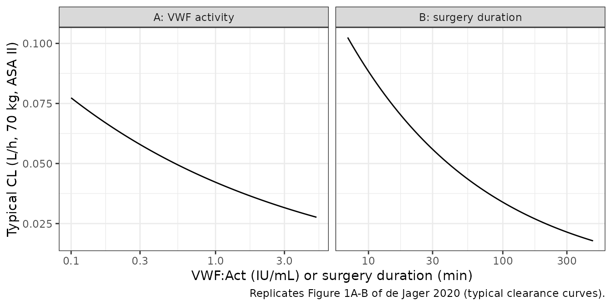
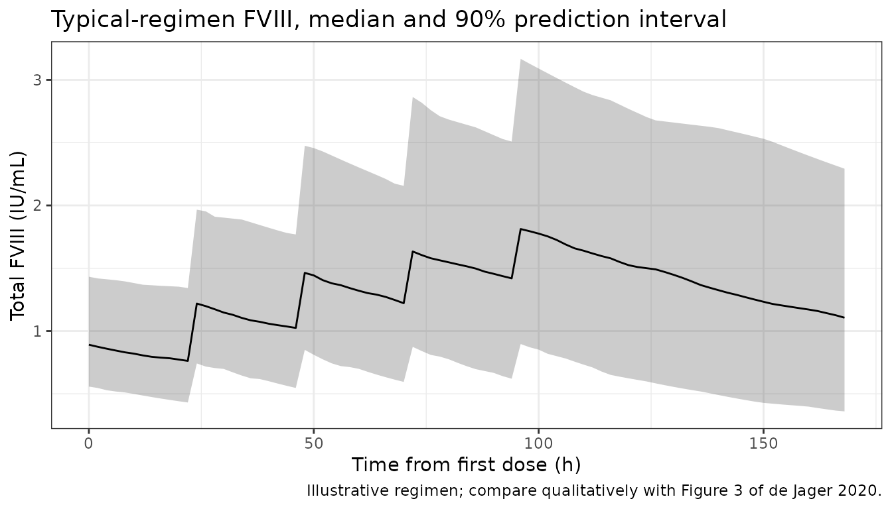

# Perioperative factor VIII after Haemate P in von Willebrand disease (de Jager 2020)

## Model and source

- Citation: de Jager NCB, Bukkems LH, Heijdra JM, Hazendonk HCAM,
  Fijnvandraat K, Meijer K, Eikenboom J, Laros-van Gorkom BAP, Leebeek
  FWG, Cnossen MH, Mathot RAA; OPTI-CLOT group. One piece of the puzzle:
  Population pharmacokinetics of FVIII during perioperative Haemate
  P/Humate P treatment in von Willebrand disease patients. *J Thromb
  Haemost.* 2020;18(2):295-305.
- Article: <https://doi.org/10.1111/jth.14652> (open access, PMC7028136)
- Supplement: Appendix S1 (population PK equations and validation
  goodness-of-fit plots), on the article page.
- Description: one-compartment population PK model for factor VIII
  (FVIII) activity after the plasma-derived VWF/FVIII concentrate
  Haemate P / Humate P (VWF:FVIII ratio 2.4:1), given perioperatively to
  patients with von Willebrand disease (VWD). The model is built on
  FVIII levels only; VWF activity enters as a time-varying covariate on
  FVIII clearance.

The final model (Table 2 footnote and Appendix S1 Eq. 2-5) is

``` math
V = 3.28 \cdot \left(\frac{WT}{70}\right)^{1} e^{\eta_V}
```

``` math
CL = 0.037 \cdot \left(\frac{WT}{70}\right)^{0.75}
  \left(\frac{\text{surgery duration}}{81\ \text{min}}\right)^{-0.416}
  \left(\frac{\text{VWF:Act}}{1.65\ \text{IU/mL}}\right)^{-0.263}
  0.555^{\text{ASA III/IV}} e^{\eta_{CL}}
```

``` math
\text{FVIII}_{obs} = (\text{baseline FVIII} + \text{FVIII}_{pred})(1 + \varepsilon)
```

with V in L, CL in L/h and FVIII in IU/mL. The baseline is the lowest
FVIII ever measured in the patient.

The paper also fits a **virtual dose**. In 92 of 180 surgeries the FVIII
level measured before the first concentrate dose was higher than the
patient’s lowest-ever baseline. The authors gave these patients a fixed
virtual dose before the pre-dose sample, with an estimated
bioavailability (F = 0.200, inter-occasion variability 154.5% CV). The
virtual dose carries the endogenous FVIII above baseline, which then
decays back to the lowest-ever level. The packaged model gives this dose
its own state, `virtual`, which eliminates at the same rate as `central`
and has `f(virtual)` set to the fitted F. Real doses go to `central`
with F = 1. The paper does not report the virtual dose amount, because
only the product of amount and F is identifiable.

## Population

The final model was estimated on all available data (Table 1): 117
patients with VWD who underwent 172 surgeries at five Dutch academic
haemophilia treatment centres between 2000 and 2018. These data were 97
patients (141 surgeries, 684 FVIII samples) in the index set and 20
patients (31 surgeries, 208 samples) in the external-validation set.
Median age was 50 years (0.5-82; seven children), median weight 77.0 kg
(8.8-118.0), and 67% were female. VWD type per occasion was 1 (47%), 2A
(27%), 2B (6%), 2M (11%), 2N (5%) and 3 (5%). ASA class was II for 83%
of occasions, III for 16% and IV for 1%. 72% of surgeries were major.
Median surgery duration was 65 min (7-470). Patients received a median
of 5 Haemate P doses per occasion, at a median 20.8 IU FVIII/kg
(5.5-66.1). Median lowest-ever FVIII was 0.41 IU/mL (0.01-0.97).

The same information is available programmatically via
`readModelDb("deJager_2020_factorviii")()$population`.

## Source trace

| Equation / parameter | Value | Source location |
|----|----|----|
| `lvc` | log(3.28 L) at 70 kg | Table 2, Final FVIII Estimate, Volume of distribution |
| `lcl` | log(0.037 L/h) at 70 kg | Table 2, Final, Clearance |
| `lfvirtual` | log(0.200) | Table 2, Final, Bioavailability virtual dose; Appendix S1 Eq. 3 |
| `e_wt_vc` | 1 (fixed a priori) | Methods 2.2; Appendix S1 Eq. 4; Table 2 footnote |
| `e_wt_cl` | 0.75 (fixed a priori) | Methods 2.2; Appendix S1 Eq. 5; Table 2 footnote |
| `e_tsurg_cl` | -0.416, reference 81 min | Table 2, Final, Surgery duration on CL; footnote |
| `e_asa_ge3_cl` | 0.555 | Table 2, Final, ASA class III or IV on CL; footnote |
| `e_vwf_cl` | -0.263, reference 1.65 IU/mL | Table 2, Final, VWF activity on CL; footnote |
| `etalcl`, `etalvc` | 84.1% CV, 30.9% CV, r = 0.47 | Table 2, Final, IIV CL, IIV V, correlation; CV definition in Table 2 abbreviations |
| `etaiov_lfvirtual_1` | 154.5% CV | Table 2, Final, IOV bioavailability virtual dose |
| `propSd` | 0.203 | Table 2, Final, proportional residual variability; Appendix S1 Eq. 2 |
| one-compartment IV structure | n/a | Results 3.1 |
| observation `Cc = (central + virtual)/vc/1000 + FVIII_BL` | n/a | Appendix S1 Eq. 2; Methods 2.2 |
| virtual dose | n/a | Methods 2.2; Results 3.1 |

Variances are `omega^2 = log(1 + CV^2)`, following the CV definition in
the Table 2 abbreviations. The V-CL covariance is
`0.47 * sqrt(omega^2_CL * omega^2_V)`.

## Typical-value checks against the paper’s numbers

``` r

mod <- readModelDb("deJager_2020_factorviii")

# Table 2 footnote, with surgery duration in minutes and VWF:Act in IU/mL.
typ_cl <- function(wt, dur_min, vwf_iu_ml, asa34) {
  0.037 * (wt / 70)^0.75 * (dur_min / 81)^-0.416 * (vwf_iu_ml / 1.65)^-0.263 * 0.555^asa34
}
typ_v <- function(wt) 3.28 * (wt / 70)

chk_cov <- data.frame(
  id = 1:5,
  WT = c(70, 70, 50, 90, 25),
  dur_min = c(81, 45, 106, 240, 30),
  vwf_iu_ml = c(1.65, 0.78, 2.21, 3.0, 0.5),
  ASA_GE3 = c(0, 0, 1, 1, 0),
  FVIII_BL = 0
) |>
  mutate(T_SURG = dur_min / 60, VWF = vwf_iu_ml * 100)
ev_chk <- bind_rows(
  chk_cov |> mutate(time = 0, evid = 1L, amt = 1000, cmt = "central"),
  chk_cov |> mutate(time = 1, evid = 0L, amt = 0, cmt = "central")
) |>
  arrange(id, time, desc(evid)) |>
  as.data.frame()
sim_chk <- as.data.frame(rxSolve(zeroRe(mod), ev_chk, keep = c("WT", "dur_min", "vwf_iu_ml", "ASA_GE3")))
#> ℹ parameter labels from comments will be replaced by 'label()'
#> ℹ omega/sigma items treated as zero: 'etalcl', 'etalvc', 'etaiov_lfvirtual_1'
#> Warning: multi-subject simulation without without 'omega'
sim_chk <- sim_chk[!duplicated(sim_chk$id), ]

# Same parameters on both sides, so the packaged model must match the
# footnote to floating-point precision.
stopifnot(
  all(abs(sim_chk$cl / typ_cl(sim_chk$WT, sim_chk$dur_min, sim_chk$vwf_iu_ml, sim_chk$ASA_GE3) - 1) < 1e-10),
  all(abs(sim_chk$vc / typ_v(sim_chk$WT) - 1) < 1e-10)
)

ref_t12 <- log(2) * typ_v(70) / typ_cl(70, 81, 1.65, 0)
tibble::tibble(
  Quantity = c(
    "Typical t1/2 at 70 kg, 81 min, VWF:Act 1.65 IU/mL, ASA II (h)",
    "CL change, surgery duration 45 -> 106 min (%)",
    "CL change, VWF:Act 0.78 -> 2.21 IU/mL (%)",
    "CL change, ASA III/IV vs II (%)"
  ),
  `From packaged model` = round(c(
    ref_t12,
    100 * ((106 / 45)^-0.416 - 1),
    100 * ((2.21 / 0.78)^-0.263 - 1),
    100 * (0.555 - 1)
  ), 1),
  Paper = c(
    "57.7 (median individual t1/2, Discussion)",
    "-38 (Results 3.2)",
    "-29 (Results 3.2)",
    "-44 (Results 3.2)"
  )
) |>
  knitr::kable(caption = "Typical values from the packaged model versus the numbers quoted in de Jager 2020.")
```

| Quantity | From packaged model | Paper |
|:---|---:|:---|
| Typical t1/2 at 70 kg, 81 min, VWF:Act 1.65 IU/mL, ASA II (h) | 61.4 | 57.7 (median individual t1/2, Discussion) |
| CL change, surgery duration 45 -\> 106 min (%) | -30.0 | -38 (Results 3.2) |
| CL change, VWF:Act 0.78 -\> 2.21 IU/mL (%) | -24.0 | -29 (Results 3.2) |
| CL change, ASA III/IV vs II (%) | -44.5 | -44 (Results 3.2) |

Typical values from the packaged model versus the numbers quoted in de
Jager 2020. {.table}

The ASA effect agrees with the text. The two interquartile-range
contrasts quoted in Results 3.2 are larger than the printed exponents
give: 38% versus 30% for surgery duration, and 29% versus 24% for VWF
activity. No exponent printed in Table 2 (structural, intermediate,
final or bootstrap) reproduces the text: the intermediate-model
exponents give 31% and 27%. The Table 2 equation is used, and the
difference is noted under Assumptions and deviations. The typical
half-life of 61 h at the reference covariates sits close to the paper’s
57.7 h median individual half-life. The PKNCA section below checks the
cohort median.

## Replicate Figure 1: clearance versus VWF activity and surgery duration

``` r

grid_vwf <- data.frame(vwf_iu_ml = exp(seq(log(0.1), log(5), length.out = 60)), dur_min = 81, panel = "A: VWF activity")
grid_dur <- data.frame(vwf_iu_ml = 1.65, dur_min = exp(seq(log(7), log(470), length.out = 60)), panel = "B: surgery duration")
fig1 <- bind_rows(grid_vwf, grid_dur) |>
  mutate(
    id = row_number(), WT = 70, ASA_GE3 = 0, FVIII_BL = 0,
    T_SURG = dur_min / 60, VWF = vwf_iu_ml * 100,
    x = ifelse(panel == "A: VWF activity", vwf_iu_ml, dur_min)
  )
ev_fig1 <- fig1 |>
  mutate(time = 0, evid = 0L, amt = 0, cmt = "central") |>
  as.data.frame()
sim_fig1 <- as.data.frame(rxSolve(zeroRe(mod), ev_fig1, keep = c("panel", "x")))
#> ℹ parameter labels from comments will be replaced by 'label()'
#> ℹ omega/sigma items treated as zero: 'etalcl', 'etalvc', 'etaiov_lfvirtual_1'
#> Warning: multi-subject simulation without without 'omega'

ggplot(sim_fig1, aes(x, cl)) +
  geom_line() +
  facet_wrap(~panel, scales = "free_x") +
  scale_x_log10() +
  labs(
    x = "VWF:Act (IU/mL) or surgery duration (min)", y = "Typical CL (L/h, 70 kg, ASA II)",
    caption = "Replicates Figure 1A-B of de Jager 2020 (typical clearance curves)."
  ) +
  theme_bw()
```



## Virtual cohort

Observed data are not public. A virtual cohort of 200 adult-weight
surgical occasions follows Table 1. Weight is log-normal around 77 kg,
truncated to 40-118 kg. Surgery duration is log-normal around 65 min,
truncated to 7-470 min. The lowest-ever FVIII is log-normal around 0.41
IU/mL, truncated to 0.01-0.97 IU/mL. ASA III/IV is assigned with
probability 26/152, and VWF:Act is log-normal around the 1.65 IU/mL
reference. The spread of VWF:Act is set from the 0.78-2.21 IU/mL
interquartile range of measured levels. VWF:Act is held constant within
each occasion (see Assumptions and deviations).

``` r

set.seed(2020)
rxode2::rxSetSeed(2020)
n_sub <- 200L
tnorm <- function(n, med, sdlog, lo, hi) pmin(pmax(exp(rnorm(n, log(med), sdlog)), lo), hi)

cohort <- tibble::tibble(
  id = seq_len(n_sub),
  WT = tnorm(n_sub, 77, 0.2, 40, 118),
  dur_min = tnorm(n_sub, 65, 0.8, 7, 470),
  VWF = 100 * tnorm(n_sub, 1.65, log(2.21 / 0.78) / (2 * qnorm(0.75)), 0.2, 6),
  ASA_GE3 = as.integer(runif(n_sub) < 26 / 152),
  FVIII_BL = tnorm(n_sub, 0.41, 0.6, 0.01, 0.97),
  treatment = "20.8 IU/kg"
) |>
  mutate(T_SURG = dur_min / 60)

cohort |>
  summarise(
    n = n(),
    `median weight (kg)` = round(median(WT), 1),
    `median surgery duration (min)` = round(median(dur_min)),
    `median VWF:Act (IU/mL)` = round(median(VWF) / 100, 2),
    `ASA III/IV (%)` = round(100 * mean(ASA_GE3)),
    `median baseline FVIII (IU/mL)` = round(median(FVIII_BL), 2)
  ) |>
  knitr::kable(caption = "Virtual cohort summary.")
```

| n | median weight (kg) | median surgery duration (min) | median VWF:Act (IU/mL) | ASA III/IV (%) | median baseline FVIII (IU/mL) |
|---:|---:|---:|---:|---:|---:|
| 200 | 78 | 60 | 1.5 | 18 | 0.45 |

Virtual cohort summary. {.table}

## Simulation 1: single median dose

A single 20.8 IU/kg dose (the Table 1 median) is given at time 0. The
lowest-ever baseline is set to 0 here so the NCA reflects the
concentrate alone. The paper’s 57.7 h half-life is computed from the
individual PK parameters.

``` r

obs_grid <- sort(unique(c(seq(0, 12, 1), seq(14, 72, 2), seq(78, 336, 6))))
ev_single <- bind_rows(
  cohort |> mutate(time = 0, evid = 1L, amt = 20.8 * WT, cmt = "central"),
  cohort |> tidyr::crossing(time = obs_grid) |> mutate(evid = 0L, amt = 0, cmt = "central")
) |>
  mutate(FVIII_BL = 0) |>
  arrange(id, time, desc(evid)) |>
  as.data.frame()

sim_single <- as.data.frame(rxSolve(mod, ev_single, keep = c("treatment", "WT")))
#> ℹ parameter labels from comments will be replaced by 'label()'
```

## PKNCA validation

``` r

nca_in <- sim_single |>
  filter(!is.na(Cc)) |>
  select(id, treatment, time, Cc)
nca_in <- bind_rows(
  nca_in,
  nca_in |> distinct(id, treatment) |> mutate(time = 0, Cc = 0)
) |>
  distinct(id, treatment, time, .keep_all = TRUE) |>
  arrange(id, time)

dose_df <- ev_single |>
  filter(evid == 1) |>
  select(id, treatment, time, amt)

conc_obj <- PKNCAconc(nca_in, Cc ~ time | treatment + id, concu = "IU/mL", timeu = "h")
dose_obj <- PKNCAdose(dose_df, amt ~ time | treatment + id, doseu = "IU", route = "intravascular")
intervals <- data.frame(
  start = 0, end = Inf,
  cmax = TRUE, aucinf.obs = TRUE, half.life = TRUE, cl.obs = TRUE
)
nca_res <- pk.nca(PKNCAdata(conc_obj, dose_obj, intervals = intervals))

published <- tibble::tribble(
  ~treatment, ~half.life,
  "20.8 IU/kg", 57.7
)
ncaComparisonTable(
  simulated = nca_res,
  reference = published,
  by = "treatment",
  params = "half.life",
  units = c(half.life = "h"),
  tolerance_pct = 20
) |>
  knitr::kable(caption = "Simulated median half-life versus the median individual half-life in de Jager 2020 (Discussion). * differs by more than 20%.")
```

| NCA parameter | treatment  | Reference | Simulated | % diff |
|:--------------|:-----------|:----------|:----------|:-------|
| t½ (h)        | 20.8 IU/kg | 57.7      | 61.8      | +7.2%  |

Simulated median half-life versus the median individual half-life in de
Jager 2020 (Discussion). \* differs by more than 20%. {.table}

The NCA half-life must also recover each subject’s own
`log(2) * V / CL`. The two sides use the same drawn parameters, so the
difference is numerical error from the terminal-phase regression and
should be small.

``` r

indiv <- sim_single |>
  distinct(id, treatment, cl, vc) |>
  mutate(t12_model = log(2) * vc / cl)
t12_nca <- as.data.frame(nca_res$result) |>
  filter(PPTESTCD == "half.life") |>
  select(id, treatment, t12_nca = PPORRES)
chk <- inner_join(indiv, t12_nca, by = c("id", "treatment")) |>
  mutate(pct_diff = 100 * (t12_nca / t12_model - 1))
chk |>
  summarise(
    `median model t1/2 (h)` = round(median(t12_model), 1),
    `median NCA t1/2 (h)` = round(median(t12_nca, na.rm = TRUE), 1),
    `median % difference` = round(median(pct_diff, na.rm = TRUE), 2)
  ) |>
  knitr::kable(caption = "NCA half-life versus model half-life.")
```

| median model t1/2 (h) | median NCA t1/2 (h) | median % difference |
|----------------------:|--------------------:|--------------------:|
|                  61.8 |                61.8 |                   0 |

NCA half-life versus model half-life. {.table}

``` r

stopifnot(
  abs(median(chk$pct_diff, na.rm = TRUE)) < 2,
  quantile(abs(chk$pct_diff), 0.9, na.rm = TRUE) < 5
)
```

## Simulation 2: perioperative regimen with endogenous baseline

This is an illustrative regimen, because the paper does not give one:
20.8 IU/kg every 24 h for five doses, the Table 1 medians for dose size
and number. The lowest-ever baseline is added to the prediction as in
the paper. The plot shows total FVIII (endogenous baseline plus
concentrate), the quantity in the Figure 3 prediction-corrected VPC.

``` r

ev_periop <- bind_rows(
  cohort |> tidyr::crossing(time = seq(0, 96, 24)) |>
    mutate(evid = 1L, amt = 20.8 * WT, cmt = "central"),
  cohort |> tidyr::crossing(time = seq(0, 168, 2)) |>
    mutate(evid = 0L, amt = 0, cmt = "central")
) |>
  arrange(id, time, desc(evid)) |>
  as.data.frame()

sim_periop <- as.data.frame(rxSolve(mod, ev_periop))

sim_periop |>
  group_by(time) |>
  summarise(med = median(Cc), lo = quantile(Cc, 0.05), hi = quantile(Cc, 0.95), .groups = "drop") |>
  ggplot(aes(time, med)) +
  geom_ribbon(aes(ymin = lo, ymax = hi), alpha = 0.25) +
  geom_line() +
  labs(
    x = "Time from first dose (h)", y = "Total FVIII (IU/mL)",
    title = "Typical-regimen FVIII, median and 90% prediction interval",
    caption = "Illustrative regimen; compare qualitatively with Figure 3 of de Jager 2020."
  ) +
  theme_bw()
```



## The virtual dose

The packaged model takes the virtual dose as an ordinary dose record on
`virtual`, and the user chooses the amount. For a patient whose pre-dose
FVIII is above the lowest-ever value, an amount of
`excess (IU/mL) * 1000 * V / F` at the pre-dose sample time reproduces
the excess at the typical F. With IOV, the realised F varies by
occasion. The check below is a typical-value solve: it confirms that the
virtual contribution enters with F = 0.200 and decays at the same rate
as the concentrate.

``` r

vd <- data.frame(id = 1:2, WT = 70, T_SURG = 1.35, VWF = 165, ASA_GE3 = 0, FVIII_BL = 0.41)
amt_virtual <- 0.30 * 1000 * 3.28 / 0.200 # gives +0.30 IU/mL above baseline at time 0
ev_vd <- bind_rows(
  vd |> filter(id == 2) |> mutate(time = 0, evid = 1L, amt = amt_virtual, cmt = "virtual"),
  vd |> tidyr::crossing(time = c(0, 24, 72)) |> mutate(evid = 0L, amt = 0, cmt = "central")
) |>
  arrange(id, time, desc(evid)) |>
  as.data.frame()
sim_vd <- as.data.frame(rxSolve(zeroRe(mod), ev_vd))
#> ℹ parameter labels from comments will be replaced by 'label()'
#> ℹ omega/sigma items treated as zero: 'etalcl', 'etalvc', 'etaiov_lfvirtual_1'
#> Warning: multi-subject simulation without without 'omega'
kel_ref <- typ_cl(70, 81, 1.65, 0) / typ_v(70)
sim_vd |>
  select(id, time, Cc) |>
  tidyr::pivot_wider(names_from = id, values_from = Cc, names_prefix = "id") |>
  mutate(expected_excess = 0.30 * exp(-kel_ref * time), simulated_excess = id2 - id1) |>
  dplyr::rename(
    "Time (h)" = time,
    "No virtual dose (IU/mL)" = id1,
    "With virtual dose (IU/mL)" = id2,
    "Expected excess (IU/mL)" = expected_excess,
    "Simulated excess (IU/mL)" = simulated_excess
  ) |>
  knitr::kable(digits = 4, caption = "Typical FVIII with and without a virtual dose at time 0 (baseline 0.41 IU/mL).")
```

| Time (h) | No virtual dose (IU/mL) | With virtual dose (IU/mL) | Expected excess (IU/mL) | Simulated excess (IU/mL) |
|---:|---:|---:|---:|---:|
| 0 | 0.41 | 0.7100 | 0.3000 | 0.3000 |
| 24 | 0.41 | 0.6388 | 0.2288 | 0.2288 |
| 72 | 0.41 | 0.5432 | 0.1332 | 0.1332 |

Typical FVIII with and without a virtual dose at time 0 (baseline 0.41
IU/mL). {.table}

``` r


base <- sim_vd$Cc[sim_vd$id == 1]
with_vd <- sim_vd$Cc[sim_vd$id == 2]
tt <- sim_vd$time[sim_vd$id == 1]
stopifnot(
  all(abs(base - 0.41) < 1e-8),
  all(abs((with_vd - base) - 0.30 * exp(-kel_ref * tt)) < 1e-6)
)
```

## Assumptions and deviations

- **Covariate units.** Surgery duration is supplied in hours (`T_SURG`),
  so the 81 min reference becomes 1.35 h. VWF activity is supplied in
  IU/dL (`VWF`), so the 1.65 IU/mL reference becomes 165 IU/dL. Both
  conversions leave the printed effects unchanged.
- **Text versus equation.** Results 3.2 quotes 38% and 29% CL decreases
  over the interquartile ranges of surgery duration and VWF activity.
  The final Table 2 exponents give 30% and 24%. No exponent printed
  anywhere in Table 2 gives the quoted numbers. The model uses the
  printed equation. The Discussion also gives the RSE of the VWF effect
  as 51%, while Table 2 shows 43.2% for the final model and 47.1% for
  the bootstrap.
- **Time-varying VWF activity.** The paper carries measured VWF:Act
  forward from each measurement to the next. Periods before the first
  dose, with a virtual dose, were handled separately; the paper does not
  say how. The virtual cohort holds VWF:Act constant per occasion. A
  user with measured VWF:Act should supply it as a time-varying `VWF`
  column.
- **Virtual dose.** The amount is not reported. The fitted F and its IOV
  are kept, and the dose is a user-supplied record on the paper-specific
  `virtual` state, eliminated at the same rate as `central`. The
  simulations above use no virtual dose except in the dedicated check.
- **Inter-occasion variability as one eta.** The IOV on F is carried as
  a single eta, `etaiov_lfvirtual_1`. That is exact when each simulated
  subject represents one surgical occasion. For a patient with several
  surgeries, simulate each occasion as its own subject.
- **Lowest-ever FVIII baseline.** The baseline is the lowest FVIII ever
  measured in the patient (Methods 2.1), not the most recent untreated
  value. The maintainers therefore registered it as `FVIII_BL`, separate
  from `FVIIIRECENT`.
- **ASA class.** Only classes II-IV occurred, so the indicator compares
  ASA III/IV with ASA II. The model has not been informed by ASA I or V
  patients.
- **Virtual cohort.** Covariate distributions were chosen to match the
  Table 1 medians and ranges, with log-normal shapes assumed. The cohort
  is adult weight only, while the source included seven children.
- **Errata.** No correction notice for this article was found as of
  2026-10-16.
