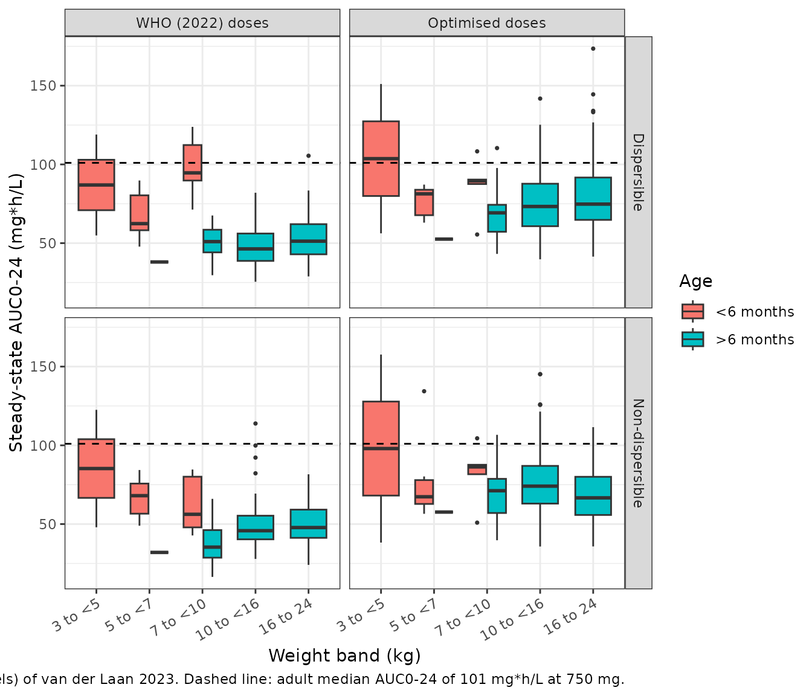
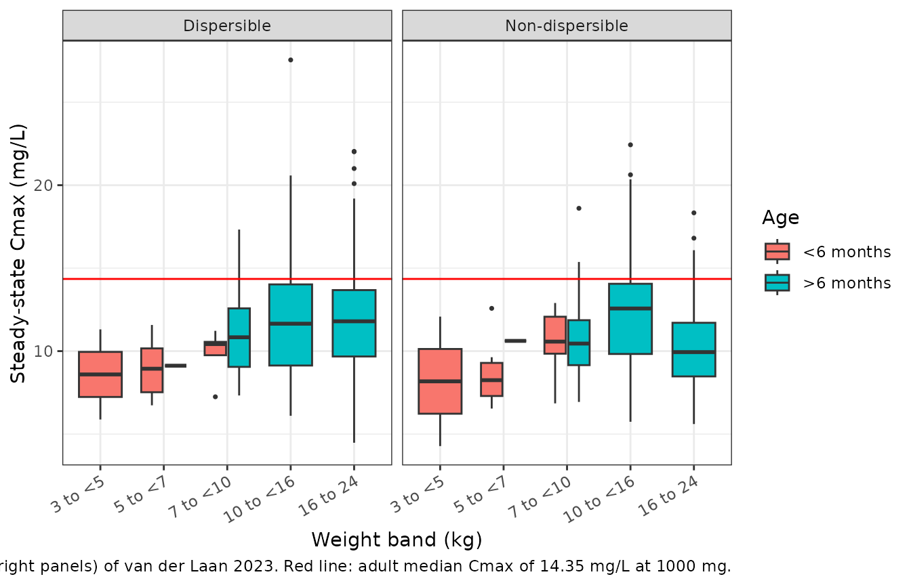
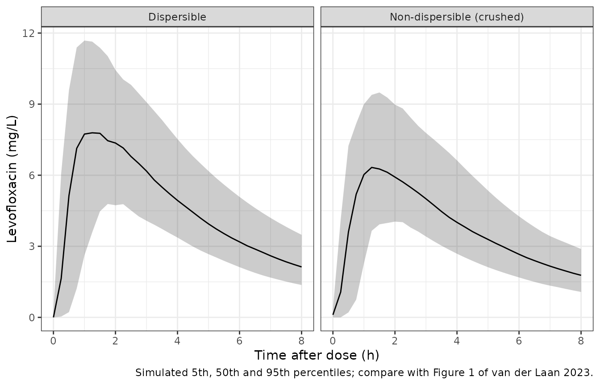

# Levofloxacin dispersible and non-dispersible tablets in young children (van der Laan 2023)

## Model and source

``` r

mod <- rxode2::rxode(readModelDb("vanderLaan_2023_levofloxacin"))
#> ℹ parameter labels from comments will be replaced by 'label()'
#> Warning: some etas defaulted to non-mu referenced, possible parsing error: etaiov_ka_1, etaiov_ka_2, etaiov_ka_3, etaiov_mtt_1, etaiov_mtt_2, etaiov_mtt_3, etaiov_fdepot_1, etaiov_fdepot_2, etaiov_fdepot_3
#> as a work-around try putting the mu-referenced expression on a simple line
```

- Citation: van der Laan LE, Hesseling AC, Schaaf HS, Palmer M, Draper
  HR, Wiesner L, Denti P, Garcia-Prats AJ. Pharmacokinetics and
  optimized dosing of dispersible and non-dispersible levofloxacin
  formulations in young children. J Antimicrob Chemother.
  2023;78(10):2481. <doi:10.1093/jac/dkad257>.
- Description: Two-compartment population PK model for oral levofloxacin
  in young South African children (aged 0.16 to 6 years) receiving
  levofloxacin preventive therapy after household exposure to
  rifampicin-resistant tuberculosis (van der Laan 2023; n = 25;
  randomised crossover of the 100 mg dispersible tablet against the
  crushed 250 mg non-dispersible adult tablet). Savic
  transit-compartment absorption (N fixed to 10, MTT fixed to 0.167 h,
  written as an explicit compartment chain) feeds first-order absorption
  into central. CL and Q scale allometrically with weight (exponent
  0.75) and Vc and Vp with exponent 1, all referenced to the
  cohort-median 12.2 kg, and CL matures with postmenstrual age through a
  Hill function (TM50 = 12.7 months, Hill = 3.95). The crushed
  non-dispersible tablet has 21.5% lower bioavailability than the
  dispersible tablet (F fixed to 1). Between-subject variability is on
  CL only; between-occasion variability is on ka, MTT and F, with the
  BOV on F inflated 3.24-fold on the occasion of the routine (non-study)
  dose that precedes the first pre-dose sample.
- Article: <https://doi.org/10.1093/jac/dkad257> (open access,
  PMC10545503)

van der Laan 2023 ran a randomised crossover in young South African
children taking levofloxacin as preventive therapy after household
exposure to rifampicin-resistant tuberculosis (RR-TB). Each child
received one dose of the 100 mg dispersible paediatric tablet and one
dose of the crushed 250 mg non-dispersible adult tablet on consecutive
pharmacokinetic days. The final model is a two-compartment model with
Savic transit-compartment absorption, allometric scaling on weight, and
maturation of clearance with postmenstrual age. Bioavailability of the
crushed non-dispersible tablet was 21.5% lower than that of the
dispersible tablet. The paper then used the model to propose optimised
weight-band doses for both formulations (Table 3).

## Population

Twenty-five HIV-negative children were included (Table 1): median (IQR)
age 2.56 (1.58-4.03) years, range 0.16-6.01 years; weight 12.2
(10.7-15.0) kg, range 4.02-20.3 kg; 15 (60%) male; 17 (68%) of mixed
race and 8 (32%) Black. Median creatinine was 24 umol/L and all had
normal renal function. Routine preventive therapy included high-dose
isoniazid (19 / 25) and ethambutol (8 / 25). On pharmacokinetic days the
children were fasted, the tablet was mixed in 2.5-5 mL of water (the
non-dispersible tablet crushed first), and samples were taken pre-dose
and at 1, 2, 4, 6 and 8 h. Of 286 samples, one pre-dose sample was below
the 0.0781 mg/L LLOQ; seven samples from two children were excluded.

``` r

str(mod$population)
#> List of 14
#>  $ species       : chr "human"
#>  $ n_subjects    : int 25
#>  $ n_studies     : int 1
#>  $ age_range     : chr "0.16 to 6.01 years"
#>  $ age_median    : chr "2.56 years (IQR 1.58-4.03)"
#>  $ weight_range  : chr "4.02 to 20.3 kg"
#>  $ weight_median : chr "12.2 kg (IQR 10.7-15.0)"
#>  $ sex_female_pct: num 40
#>  $ race_ethnicity: Named num [1:2] 68 32
#>   ..- attr(*, "names")= chr [1:2] "MixedRace" "Black"
#>  $ disease_state : chr "HIV-negative children under 6 years receiving levofloxacin preventive therapy (for at least 2 weeks) after hous"| __truncated__
#>  $ dose_range    : chr "Single oral doses of about 15-20 mg/kg on each of two pharmacokinetic days, one with the 100 mg dispersible tab"| __truncated__
#>  $ sampling      : chr "Pre-dose and 1, 2, 4, 6 and 8 h post-dose on both pharmacokinetic days; 286 samples, LLOQ 0.0781 mg/L, BLQ handled by Beal M3."
#>  $ regions       : chr "South Africa (Cape Town)."
#>  $ notes         : chr "Demographics from van der Laan 2023 Table 1 (median creatinine 24 umol/L, median fat-free mass 9.89 kg). Age st"| __truncated__
```

## Source trace

Every `ini()` value comes from van der Laan 2023 Table 2; the equations
come from the Methods and Results text.

| Element | Value in model | Source |
|----|----|----|
| `lcl` | log(4.17) L/h | Table 2 ‘Clearance’; footnote: estimates for a child of median weight 12.2 kg |
| `lvc` | log(19.7) L | Table 2 ‘Volume of distribution’ |
| `lq` | log(0.638) L/h | Table 2 ‘Intercompartmental clearance’ |
| `lvp` | log(5.53) L | Table 2 ‘Peripheral volume of distribution’ |
| `lka` | log(2.52) 1/h | Table 2 ‘Absorption rate constant’ |
| `lmtt` | fixed(log(0.167)) h | Table 2 ‘Mean transit time’, fixed |
| N = 10 transit compartments | `transit1`-`transit10` in `model()`, `ktr = 11 / mtt` | Table 2 ‘No. of transit compartments’ 10, fixed; Results: estimate not stable, so fixed |
| `lfdepot` | fixed(log(1)) | Table 2 ‘Bioavailability for dispersible tablet’ 100%, fixed (reference) |
| `e_form_levofloxacin_nondispersible_fdepot` | -0.215 | Table 2 ‘Effect of crushed non-dispersible tablet on bioavailability’ -21.5% |
| `ltm50_cl` | log(12.7) months | Table 2 maturation ‘Postmenstrual age at which 50% of maturation is reached’ |
| `lhill_cl` | log(3.95) | Table 2 maturation ‘Shape factor of the curve’ |
| `e_wt_cl_q`, `e_wt_vc_vp` | fixed 0.75, fixed 1 | Methods: allometric scaling of all clearances and volumes (exponents not printed; see Assumptions) |
| `etalcl` | 0.093^2 | Table 2 BSV CL 9.30% |
| `etaiov_ka_*` | 0.542^2 | Table 2 BOV ka 54.2% |
| `etaiov_mtt_*` | 0.982^2 | Table 2 BOV MTT 98.2% |
| `etaiov_fdepot_*` | 0.226^2 | Table 2 BOV F 22.6% |
| `sd_ratio_fdepot_occ1` | 3.24 | Table 2 ‘Scaling of between-occasion variability in bioavailability for pre-doses’ 3.24-fold |
| `addSd` | 0.112 mg/L | Table 2 ‘Additive error’ |
| `propSd` | 0.0533 | Table 2 ‘Proportional error’ 5.33% |
| Two-compartment disposition, transit absorption | – | Results, paragraph 3 |
| Savic transit input, ktr = (N + 1) / MTT | explicit chain `depot` -\> `transit1`…`transit10` -\> `transit11` (ka) | Methods (transit compartments, reference 11) |
| Combined additive + proportional error | – | Methods |
| Pre-dose samples as a separate occasion | – | Methods; Results last paragraph |

## Virtual cohorts

Weight is drawn around an approximate WHO median weight-for-age curve
(the two sexes averaged), with a 13% log-normal spread. The cohorts are
approximations: the paper’s dosing simulations drew on a published in
silico population of 86,271 children with tuberculosis (reference 18 of
the paper), which is not available here.

``` r

# Approximate WHO median weight-for-age (kg), the two sexes averaged; age in
# years.
who_age <- c(0, 1, 2, 3, 4, 5, 6, 9, 12, 18, 24, 36, 48, 60, 72, 84, 96, 108, 120) / 12
who_wt <- c(
  3.25, 4.35, 5.35, 6.1, 6.7, 7.2, 7.6, 8.55, 9.25, 10.55, 11.85,
  14.1, 16.2, 18.25, 20.35, 22.65, 25.2, 28.15, 31.55
)
who_median_wt <- function(age) stats::approx(who_age, who_wt, xout = age, rule = 2)$y

# Weight band and optimised-dose lookup (van der Laan 2023 Table 3). Weight
# bands are 3-<5, 5-<7, 7-<10, 10-<16 and 16-24 kg.
band_breaks <- c(3, 5, 7, 10, 16, 24.0001)
band_labels <- c("3 to <5", "5 to <7", "7 to <10", "10 to <16", "16 to 24")
dose_table <- tibble::tribble(
  ~band, ~young, ~disp_who, ~disp_opt, ~ndisp_who, ~ndisp_opt,
  "3 to <5", TRUE, 50, 50, 50, 50,
  "5 to <7", TRUE, 100, 100, 125, 125,
  "7 to <10", TRUE, 150, 150, 125, 175,
  "3 to <5", FALSE, 50, 80, 50, 100,
  "5 to <7", FALSE, 100, 150, 125, 175,
  "7 to <10", FALSE, 150, 200, 125, 250,
  "10 to <16", FALSE, 200, 300, 250, 375,
  "16 to 24", FALSE, 300, 450, 375, 500
)
```

## Typical-value checks

### Steady-state AUC identity

For linear PK, the steady-state AUC over one dosing interval equals
`F * Dose / CL`. Solving the typical 12.2-kg, 2.56-year-old child for
five daily 200 mg doses and integrating the last interval must reproduce
it. This checks that the transit chain delivers the whole dose exactly
once, and the units.

``` r

mod_typ <- rxode2::zeroRe(mod)
#> Warning: some etas defaulted to non-mu referenced, possible parsing error: etaiov_ka_1, etaiov_ka_2, etaiov_ka_3, etaiov_mtt_1, etaiov_mtt_2, etaiov_mtt_3, etaiov_fdepot_1, etaiov_fdepot_2, etaiov_fdepot_3
#> as a work-around try putting the mu-referenced expression on a simple line
ev_ss <- rxode2::et(amt = 200, ii = 24, addl = 4, cmt = "depot") |>
  rxode2::et(seq(96, 120, by = 0.02), cmt = "central") |>
  as.data.frame() |>
  dplyr::mutate(id = 1L, WT = 12.2, AGE = 2.56, OCC = 0, FORM_LEVOFLOXACIN_NONDISPERSIBLE = 0)
ss <- as.data.frame(rxode2::rxSolve(mod_typ, ev_ss, atol = 1e-10, rtol = 1e-10))
#> ℹ omega/sigma items treated as zero: 'etalcl', 'etaiov_ka_1', 'etaiov_ka_2', 'etaiov_ka_3', 'etaiov_mtt_1', 'etaiov_mtt_2', 'etaiov_mtt_3', 'etaiov_fdepot_1', 'etaiov_fdepot_2', 'etaiov_fdepot_3'
ss_last <- dplyr::filter(ss, time >= 96)
auc_ss <- sum(diff(ss_last$time) * (head(ss_last$Cc, -1) + tail(ss_last$Cc, -1)) / 2)
auc_cf <- 200 / ss_last$cl[1]
c(trapezoid = auc_ss, closed_form = auc_cf, cl = ss_last$cl[1])
#>   trapezoid closed_form          cl 
#>   48.491997   48.492310    4.124365
# A doubled transit input, a lost dose or a unit slip moves this by >= 2-fold.
stopifnot(abs(auc_ss / auc_cf - 1) < 0.005)
```

The typical CL of this child is 4.12 L/h. That is 1.1% below the Table 2
value of 4.17 L/h, because the maturation factor at 2.56 years is 0.989
rather than 1 (see Assumptions).

### Exposure by weight band at the WHO and optimised doses

Representative children are placed at the centre of each weight band, at
the age whose WHO median weight matches. Infants under 6 months are
placed at 0.25 years.

``` r

rep_kids <- dplyr::bind_rows(
  tibble::tibble(band = band_labels[1:3], young = TRUE, WT = c(4, 6, 8.5), AGE = 0.25),
  tibble::tibble(band = band_labels, young = FALSE, WT = c(4, 6, 8.5, 13, 20)) |>
    dplyr::mutate(AGE = pmax(0.5, stats::approx(who_wt, who_age, xout = WT, rule = 2)$y))
) |>
  dplyr::left_join(dose_table, by = c("band", "young")) |>
  tidyr::pivot_longer(c(disp_who, disp_opt, ndisp_who, ndisp_opt),
    names_to = c("formulation", "regimen"), names_sep = "_", values_to = "dose"
  ) |>
  dplyr::mutate(id = dplyr::row_number(), FORM_LEVOFLOXACIN_NONDISPERSIBLE = as.numeric(formulation == "ndisp"))

ev_rep <- dplyr::bind_rows(lapply(seq_len(nrow(rep_kids)), function(i) {
  k <- rep_kids[i, ]
  rxode2::et(amt = k$dose, ii = 24, addl = 4, cmt = "depot") |>
    rxode2::et(seq(96, 120, by = 0.02), cmt = "central") |>
    as.data.frame() |>
    dplyr::mutate(id = k$id, WT = k$WT, AGE = k$AGE, OCC = 0,
      FORM_LEVOFLOXACIN_NONDISPERSIBLE = k$FORM_LEVOFLOXACIN_NONDISPERSIBLE)
}))
sim_rep <- as.data.frame(rxode2::rxSolve(mod_typ, ev_rep, atol = 1e-10, rtol = 1e-10))
#> ℹ omega/sigma items treated as zero: 'etalcl', 'etaiov_ka_1', 'etaiov_ka_2', 'etaiov_ka_3', 'etaiov_mtt_1', 'etaiov_mtt_2', 'etaiov_mtt_3', 'etaiov_fdepot_1', 'etaiov_fdepot_2', 'etaiov_fdepot_3'
#> Warning: multi-subject simulation without without 'omega'
typ <- sim_rep |>
  dplyr::filter(time >= 96) |>
  dplyr::group_by(id) |>
  dplyr::summarise(
    auc = sum(diff(time) * (head(Cc, -1) + tail(Cc, -1)) / 2),
    cmax = max(Cc), .groups = "drop"
  ) |>
  dplyr::left_join(rep_kids, by = "id")

typ |>
  dplyr::mutate(age_group = ifelse(young, "<6 months", ">6 months")) |>
  dplyr::select(age_group, band, WT, AGE, formulation, regimen, dose, auc, cmax) |>
  dplyr::arrange(dplyr::desc(age_group), formulation, regimen, WT) |>
  dplyr::mutate(AGE = round(AGE, 2), auc = round(auc, 1), cmax = round(cmax, 2)) |>
  dplyr::rename(
    "Age group" = age_group, "Weight band (kg)" = band, "Weight (kg)" = WT,
    "Age (y)" = AGE, "Formulation" = formulation, "Regimen" = regimen,
    "Dose (mg)" = dose, "AUC0-24,ss (mg*h/L)" = auc, "Cmax,ss (mg/L)" = cmax
  ) |>
  knitr::kable(caption = "Typical-value steady-state exposure per weight band (disp = dispersible, ndisp = crushed non-dispersible; who = WHO 2022 dose, opt = optimised dose).")
```

| Age group | Weight band (kg) | Weight (kg) | Age (y) | Formulation | Regimen | Dose (mg) | AUC0-24,ss (mg\*h/L) | Cmax,ss (mg/L) |
|:---|:---|---:|---:|:---|:---|---:|---:|---:|
| \>6 months | 3 to \<5 | 4.0 | 0.50 | disp | opt | 80 | 67.2 | 10.11 |
| \>6 months | 5 to \<7 | 6.0 | 0.50 | disp | opt | 150 | 93.0 | 12.97 |
| \>6 months | 7 to \<10 | 8.5 | 0.74 | disp | opt | 200 | 79.3 | 11.95 |
| \>6 months | 10 to \<16 | 13.0 | 2.51 | disp | opt | 300 | 69.4 | 11.45 |
| \>6 months | 16 to 24 | 20.0 | 5.83 | disp | opt | 450 | 74.5 | 11.42 |
| \>6 months | 3 to \<5 | 4.0 | 0.50 | disp | who | 50 | 42.0 | 6.32 |
| \>6 months | 5 to \<7 | 6.0 | 0.50 | disp | who | 100 | 62.0 | 8.64 |
| \>6 months | 7 to \<10 | 8.5 | 0.74 | disp | who | 150 | 59.5 | 8.96 |
| \>6 months | 10 to \<16 | 13.0 | 2.51 | disp | who | 200 | 46.3 | 7.63 |
| \>6 months | 16 to 24 | 20.0 | 5.83 | disp | who | 300 | 49.7 | 7.61 |
| \>6 months | 3 to \<5 | 4.0 | 0.50 | ndisp | opt | 100 | 66.0 | 9.92 |
| \>6 months | 5 to \<7 | 6.0 | 0.50 | ndisp | opt | 175 | 85.2 | 11.87 |
| \>6 months | 7 to \<10 | 8.5 | 0.74 | ndisp | opt | 250 | 77.8 | 11.72 |
| \>6 months | 10 to \<16 | 13.0 | 2.51 | ndisp | opt | 375 | 68.1 | 11.24 |
| \>6 months | 16 to 24 | 20.0 | 5.83 | ndisp | opt | 500 | 65.0 | 9.96 |
| \>6 months | 3 to \<5 | 4.0 | 0.50 | ndisp | who | 50 | 33.0 | 4.96 |
| \>6 months | 5 to \<7 | 6.0 | 0.50 | ndisp | who | 125 | 60.8 | 8.48 |
| \>6 months | 7 to \<10 | 8.5 | 0.74 | ndisp | who | 125 | 38.9 | 5.86 |
| \>6 months | 10 to \<16 | 13.0 | 2.51 | ndisp | who | 250 | 45.4 | 7.49 |
| \>6 months | 16 to 24 | 20.0 | 5.83 | ndisp | who | 375 | 48.8 | 7.47 |
| \<6 months | 3 to \<5 | 4.0 | 0.25 | disp | opt | 50 | 62.3 | 7.00 |
| \<6 months | 5 to \<7 | 6.0 | 0.25 | disp | opt | 100 | 91.9 | 9.65 |
| \<6 months | 7 to \<10 | 8.5 | 0.25 | disp | opt | 150 | 106.1 | 10.54 |
| \<6 months | 3 to \<5 | 4.0 | 0.25 | disp | who | 50 | 62.3 | 7.00 |
| \<6 months | 5 to \<7 | 6.0 | 0.25 | disp | who | 100 | 91.9 | 9.65 |
| \<6 months | 7 to \<10 | 8.5 | 0.25 | disp | who | 150 | 106.1 | 10.54 |
| \<6 months | 3 to \<5 | 4.0 | 0.25 | ndisp | opt | 50 | 48.9 | 5.49 |
| \<6 months | 5 to \<7 | 6.0 | 0.25 | ndisp | opt | 125 | 90.2 | 9.47 |
| \<6 months | 7 to \<10 | 8.5 | 0.25 | ndisp | opt | 175 | 97.2 | 9.65 |
| \<6 months | 3 to \<5 | 4.0 | 0.25 | ndisp | who | 50 | 48.9 | 5.49 |
| \<6 months | 5 to \<7 | 6.0 | 0.25 | ndisp | who | 125 | 90.2 | 9.47 |
| \<6 months | 7 to \<10 | 8.5 | 0.25 | ndisp | who | 125 | 69.4 | 6.89 |

Typical-value steady-state exposure per weight band (disp = dispersible,
ndisp = crushed non-dispersible; who = WHO 2022 dose, opt = optimised
dose). {.table style="width:100%;"}

The paper’s three headline findings hold for the typical child:

- At the WHO 2022 doses every child over 6 months stays below the adult
  reference AUC0-24 of 101 mg\*h/L (Results and Figure 2, left panels).
- The optimised doses raise exposure towards that reference while the
  typical Cmax stays below the adult 1000 mg median Cmax of 14.35 mg/L
  (Figure 2, right panels).
- At equal doses the crushed non-dispersible tablet gives 78.5% of the
  dispersible-tablet exposure (Abstract, Table 2).

``` r

older <- dplyr::filter(typ, !young)
stopifnot(
  all(older$auc[older$regimen == "who"] < 101),
  all(older$auc[older$regimen == "opt"] > 55 & older$auc[older$regimen == "opt"] < 110),
  all(older$cmax[older$regimen == "opt"] < 14.35)
)
# Equal-dose exposure ratio between formulations: deterministic, so tight.
same_dose <- typ |>
  dplyr::filter(band == "3 to <5", young, regimen == "who") |>
  dplyr::arrange(formulation)
ratio_typ <- same_dose$auc[same_dose$formulation == "ndisp"] / same_dose$auc[same_dose$formulation == "disp"]
ratio_typ
#> [1] 0.785
stopifnot(abs(ratio_typ - 0.785) < 0.002)
```

## Replicate Figure 2

The figure below simulates 200 children per formulation and regimen (one
shared cohort of 200 children, each dosed under all four schemes), with
between-subject variability and one occasion of between-occasion
variability. Each child is dosed daily for five days and the last 24 h
are integrated.

``` r

set.seed(20231002)
rxode2::rxSetSeed(20231002)
n_fig <- 200
cand <- tibble::tibble(AGE = stats::runif(4 * n_fig, 0, 8)) |>
  dplyr::mutate(WT = who_median_wt(AGE) * exp(stats::rnorm(dplyr::n(), 0, 0.13))) |>
  dplyr::filter(WT >= 3, WT <= 24)
fig_kids <- cand[seq_len(n_fig), ] |>
  dplyr::mutate(
    child = dplyr::row_number(),
    band = as.character(cut(WT, band_breaks, labels = band_labels, right = FALSE)),
    young = AGE < 0.5 & WT < 10
  ) |>
  dplyr::left_join(dose_table, by = c("band", "young")) |>
  tidyr::pivot_longer(c(disp_who, disp_opt, ndisp_who, ndisp_opt),
    names_to = c("formulation", "regimen"), names_sep = "_", values_to = "dose"
  ) |>
  dplyr::mutate(
    id = dplyr::row_number(),
    FORM_LEVOFLOXACIN_NONDISPERSIBLE = as.numeric(formulation == "ndisp")
  )
stopifnot(!anyNA(fig_kids$dose))
dplyr::count(fig_kids, formulation, regimen)
#> # A tibble: 4 × 3
#>   formulation regimen     n
#>   <chr>       <chr>   <int>
#> 1 disp        opt       200
#> 2 disp        who       200
#> 3 ndisp       opt       200
#> 4 ndisp       who       200

obs_grid <- c(96, seq(96.25, 104, by = 0.25), seq(105, 120, by = 1))
ev_fig <- dplyr::bind_rows(
  fig_kids |> dplyr::transmute(id, time = 0, amt = dose, ii = 24, addl = 4, evid = 1, cmt = "depot",
    WT, AGE, FORM_LEVOFLOXACIN_NONDISPERSIBLE),
  fig_kids |> dplyr::select(id, WT, AGE, FORM_LEVOFLOXACIN_NONDISPERSIBLE) |>
    tidyr::crossing(time = obs_grid) |>
    dplyr::mutate(amt = 0, ii = 0, addl = 0, evid = 0, cmt = "central")
) |>
  dplyr::mutate(OCC = 2) |>
  dplyr::arrange(id, time, dplyr::desc(evid))

sim_fig <- as.data.frame(rxode2::rxSolve(mod, ev_fig, returnType = "data.frame"))
fig_exp <- sim_fig |>
  dplyr::filter(time >= 96) |>
  dplyr::group_by(id) |>
  dplyr::summarise(
    auc = sum(diff(time) * (head(Cc, -1) + tail(Cc, -1)) / 2),
    cmax = max(Cc), .groups = "drop"
  ) |>
  dplyr::left_join(fig_kids, by = "id") |>
  dplyr::mutate(
    band = factor(band, levels = band_labels),
    age_group = ifelse(young, "<6 months", ">6 months"),
    formulation = factor(formulation, c("disp", "ndisp"), c("Dispersible", "Non-dispersible")),
    regimen = factor(regimen, c("who", "opt"), c("WHO (2022) doses", "Optimised doses"))
  )
```

``` r

ggplot(fig_exp, aes(band, auc, fill = age_group)) +
  geom_boxplot(outlier.size = 0.6) +
  geom_hline(yintercept = 101, linetype = "dashed") +
  facet_grid(formulation ~ regimen) +
  labs(
    x = "Weight band (kg)", y = "Steady-state AUC0-24 (mg*h/L)", fill = "Age",
    caption = "Replicates Figure 2 (left and middle panels) of van der Laan 2023. Dashed line: adult median AUC0-24 of 101 mg*h/L at 750 mg."
  ) +
  theme_bw() +
  theme(axis.text.x = element_text(angle = 30, hjust = 1))
```



``` r

fig_exp |>
  dplyr::filter(regimen == "Optimised doses") |>
  ggplot(aes(band, cmax, fill = age_group)) +
  geom_boxplot(outlier.size = 0.6) +
  geom_hline(yintercept = 14.35, colour = "red") +
  facet_wrap(~formulation) +
  labs(
    x = "Weight band (kg)", y = "Steady-state Cmax (mg/L)", fill = "Age",
    caption = "Replicates Figure 2 (right panels) of van der Laan 2023. Red line: adult median Cmax of 14.35 mg/L at 1000 mg."
  ) +
  theme_bw() +
  theme(axis.text.x = element_text(angle = 30, hjust = 1))
```



``` r

fig_med <- fig_exp |>
  dplyr::filter(!young) |>
  dplyr::group_by(formulation, regimen) |>
  dplyr::summarise(
    n = dplyr::n(),
    median_auc = stats::median(auc),
    pct_auc_ge_101 = 100 * mean(auc >= 101),
    median_cmax = stats::median(cmax),
    .groups = "drop"
  )
fig_med |>
  dplyr::mutate(dplyr::across(c(median_auc, pct_auc_ge_101, median_cmax), \(x) round(x, 1))) |>
  dplyr::rename(
    "Formulation" = formulation, "Regimen" = regimen, "N (>6 months)" = n,
    "Median AUC0-24 (mg*h/L)" = median_auc, "% with AUC >= 101" = pct_auc_ge_101,
    "Median Cmax (mg/L)" = median_cmax
  ) |>
  knitr::kable(caption = "Simulated exposure in children over 6 months, pooled across weight bands.")
```

| Formulation | Regimen | N (\>6 months) | Median AUC0-24 (mg\*h/L) | % with AUC \>= 101 | Median Cmax (mg/L) |
|:---|:---|---:|---:|---:|---:|
| Dispersible | WHO (2022) doses | 187 | 49.3 | 0.5 | 7.7 |
| Dispersible | Optimised doses | 187 | 72.9 | 10.7 | 11.4 |
| Non-dispersible | WHO (2022) doses | 187 | 46.2 | 0.5 | 7.3 |
| Non-dispersible | Optimised doses | 187 | 69.3 | 8.0 | 10.8 |

Simulated exposure in children over 6 months, pooled across weight
bands. {.table}

``` r


# Cohort-level checks on the centre of the distribution only. The WHO medians
# sit near 50 mg*h/L in Figure 2, and the optimised ones near 75; a dose,
# formulation or clearance error moves these by tens of percent.
who_med <- fig_med$median_auc[fig_med$regimen == "WHO (2022) doses"]
opt_med <- fig_med$median_auc[fig_med$regimen == "Optimised doses"]
stopifnot(all(who_med > 35 & who_med < 75), all(opt_med > 55 & opt_med < 100))
```

The simulated medians reproduce the pattern of Figure 2. In children
over 6 months the pooled median AUC0-24 at WHO doses is about half the
adult reference. The optimised doses lift it to roughly 70% of the
reference, with median Cmax below the red line. Infants under 6 months,
whose clearance is still maturing, reach higher exposures from the same
weight-band dose. The paper reports the same picture: “median exposures
below adult-equivalent exposures … mainly in children \>6 months”, with
optimised medians still below 101 mg\*h/L (Figure 2, middle panels).

## Trial replication and PKNCA

The crossover is simulated in a cohort shaped like Table 1: 150
children, age log-normal around the 2.56-year median (IQR 1.58-4.03),
truncated to 0.16-6.01 years, and weight around the WHO median for age,
truncated to 4.02-20.3 kg. Each child gets 17.5 mg/kg rounded to 25 mg
(the middle of the 15-20 mg/kg target) of each formulation on
consecutive days, in randomised order. Day 1 is occasion 2 and day 2 is
occasion 3.

``` r

set.seed(37596982)
n_trial <- 150
trial_kids <- tibble::tibble(
  AGE = exp(stats::rnorm(4 * n_trial, log(2.56), 0.694))
) |>
  dplyr::filter(AGE >= 0.16, AGE <= 6.01) |>
  dplyr::mutate(WT = who_median_wt(AGE) * exp(stats::rnorm(dplyr::n(), 0, 0.13))) |>
  dplyr::filter(WT >= 4.02, WT <= 20.3) |>
  dplyr::slice_head(n = n_trial) |>
  dplyr::mutate(
    id = dplyr::row_number(),
    dose = pmax(25, round(17.5 * WT / 25) * 25),
    seq_disp_first = stats::rbinom(dplyr::n(), 1, 0.5)
  )
stopifnot(nrow(trial_kids) == n_trial)
summary(trial_kids[, c("AGE", "WT", "dose")])
#>       AGE               WT              dose      
#>  Min.   :0.5224   Min.   : 6.078   Min.   :100.0  
#>  1st Qu.:1.4751   1st Qu.:10.331   1st Qu.:175.0  
#>  Median :2.2845   Median :12.461   Median :225.0  
#>  Mean   :2.5070   Mean   :12.697   Mean   :221.3  
#>  3rd Qu.:3.3233   3rd Qu.:14.567   3rd Qu.:250.0  
#>  Max.   :5.8422   Max.   :19.923   Max.   :350.0

trial_grid <- sort(unique(c(seq(0, 24, by = 0.25), 1, 2, 4, 6, 8)))
ev_trial <- dplyr::bind_rows(
  trial_kids |> tidyr::crossing(period = 1:2) |>
    dplyr::transmute(id, time = 24 * (period - 1), amt = dose, evid = 1, cmt = "depot", period,
      WT, AGE, seq_disp_first),
  # The 24-h sample belongs to period 2 so that the occasion and formulation
  # covariates switch exactly at the day-2 dose; it still closes period 1 in
  # the NCA below (a dose into the depot does not move Cc instantaneously).
  trial_kids |> tidyr::crossing(period = 1:2, tpd = trial_grid) |>
    dplyr::filter(!(period == 1 & tpd == 24)) |>
    dplyr::transmute(id, time = 24 * (period - 1) + tpd, amt = 0, evid = 0, cmt = "central",
      period, WT, AGE, seq_disp_first)
) |>
  dplyr::mutate(
    OCC = period + 1,
    FORM_LEVOFLOXACIN_NONDISPERSIBLE = ifelse((period == 1) == (seq_disp_first == 1), 0, 1)
  ) |>
  dplyr::arrange(id, time, dplyr::desc(evid))

sim_trial <- as.data.frame(rxode2::rxSolve(mod, ev_trial, returnType = "data.frame"))
```

``` r

sim_trial |>
  dplyr::filter(time <= 8 | (time >= 24 & time <= 32)) |>
  dplyr::mutate(
    tpd = ifelse(time >= 24, time - 24, time),
    formulation = ifelse(FORM_LEVOFLOXACIN_NONDISPERSIBLE == 1, "Non-dispersible (crushed)", "Dispersible")
  ) |>
  dplyr::filter(tpd <= 8) |>
  dplyr::group_by(formulation, tpd) |>
  dplyr::summarise(
    p05 = stats::quantile(Cc, 0.05), p50 = stats::median(Cc), p95 = stats::quantile(Cc, 0.95),
    .groups = "drop"
  ) |>
  ggplot(aes(tpd, p50)) +
  geom_ribbon(aes(ymin = p05, ymax = p95), alpha = 0.25) +
  geom_line() +
  facet_wrap(~formulation) +
  labs(
    x = "Time after dose (h)", y = "Levofloxacin (mg/L)",
    caption = "Simulated 5th, 50th and 95th percentiles; compare with Figure 1 of van der Laan 2023."
  ) +
  theme_bw()
```



``` r

# The 24-h sample closes period 1 and opens period 2; give each period its own
# copy on its own time-after-dose axis.
conc_p1 <- sim_trial |>
  dplyr::filter(time <= 24) |>
  dplyr::mutate(tpd = time)
conc_p2 <- sim_trial |>
  dplyr::filter(time >= 24) |>
  dplyr::mutate(tpd = time - 24)
trt_lookup <- trial_kids |>
  tidyr::crossing(period = 1:2) |>
  dplyr::mutate(treatment = ifelse((period == 1) == (seq_disp_first == 1), "Dispersible", "Non-dispersible")) |>
  dplyr::select(id, period, treatment, dose)
conc_nca <- dplyr::bind_rows(
  dplyr::mutate(conc_p1, period = 1L),
  dplyr::mutate(conc_p2, period = 2L)
) |>
  dplyr::filter(!is.na(Cc)) |>
  dplyr::distinct(id, period, tpd, .keep_all = TRUE) |>
  dplyr::left_join(trt_lookup, by = c("id", "period")) |>
  dplyr::select(id, period, treatment, tpd, Cc)
dose_nca <- trt_lookup |>
  dplyr::mutate(tpd = 0, amt = dose) |>
  dplyr::select(id, period, treatment, tpd, amt)
stopifnot(all(dplyr::count(conc_nca, id, period, tpd)$n == 1))

conc_obj <- PKNCA::PKNCAconc(conc_nca, Cc ~ tpd | treatment + id, concu = "mg/L", timeu = "h")
dose_obj <- PKNCA::PKNCAdose(dose_nca, amt ~ tpd | treatment + id, doseu = "mg")
intervals <- data.frame(start = 0, end = 24, cmax = TRUE, tmax = TRUE, auclast = TRUE)
nca_res <- PKNCA::pk.nca(PKNCA::PKNCAdata(conc_obj, dose_obj, intervals = intervals))
nca_tab <- as.data.frame(nca_res$result)
summary(nca_res)
#>  Interval Start Interval End       treatment   N AUClast (h*mg/L) Cmax (mg/L)
#>               0           24     Dispersible 150      50.0 [24.9] 8.17 [25.7]
#>               0           24 Non-dispersible 150      40.8 [27.0] 6.58 [25.0]
#>            Tmax (h)
#>  1.25 [0.500, 3.00]
#>  1.50 [0.500, 3.25]
#> 
#> Caption: AUClast, Cmax: geometric mean and geometric coefficient of variation; Tmax: median and range; N: number of subjects
```

### Comparison against the published exposure

The paper reports one exposure figure from this study: a
dispersible-tablet AUC0-24 of 60.0 mg*h/L (Discussion, compared against
89.3 mg*h/L in an earlier study). The non-dispersible value is not
printed; the Table 2 effect implies 78.5% of the dispersible value at
equal dose.

``` r

reference <- data.frame(treatment = "Dispersible", auclast = 60.0)
cmp <- nlmixr2lib::ncaComparisonTable(
  simulated = nca_tab |>
    dplyr::filter(PPTESTCD %in% c("auclast"), treatment == "Dispersible") |>
    dplyr::select(treatment, PPTESTCD, PPORRES),
  reference = reference,
  by = "treatment",
  units = c(auclast = "mg*h/L")
)
knitr::kable(cmp, caption = "Simulated median versus published dispersible-tablet AUC0-24.")
```

| NCA parameter     | treatment   | Reference | Simulated | % diff |
|:------------------|:------------|:----------|:----------|:-------|
| AUClast (mg\*h/L) | Dispersible | 60        | 50.3      | -16.2% |

Simulated median versus published dispersible-tablet AUC0-24. {.table}

``` r

attr(cmp, "footnote")
#> NULL
```

``` r

auc_wide <- nca_tab |>
  dplyr::filter(PPTESTCD == "auclast") |>
  dplyr::select(id, treatment, PPORRES) |>
  tidyr::pivot_wider(names_from = treatment, values_from = PPORRES)
ratio <- auc_wide$`Non-dispersible` / auc_wide$Dispersible
gm_ratio <- exp(mean(log(ratio)))
c(geometric_mean_ratio = gm_ratio, median_disp_auc = stats::median(auc_wide$Dispersible))
#> geometric_mean_ratio      median_disp_auc 
#>            0.8151799           50.2916888
# Within-child ratio of two occasions: its log SD is about 0.32 from the F
# BOV, so the geometric mean of 150 ratios has a standard error near 2.6%.
# A wrong sign or a dropped formulation effect moves it by >= 20%.
stopifnot(abs(log(gm_ratio / 0.785)) < 0.10)
# Centre only: the dispersible median sits near 50 mg*h/L in this cohort.
stopifnot(stats::median(auc_wide$Dispersible) > 35, stats::median(auc_wide$Dispersible) < 75)
```

The simulated dispersible-tablet median AUC0-24 is somewhat below the
60.0 mg\*h/L the paper reports. The doses here are a fixed 17.5 mg/kg;
the trial doses are only described as “as close to 15-20 mg/kg”, and the
virtual weight-for-age relation is approximate. The comparison is shown
for information and is not asserted on.

## Assumptions and deviations

- **Allometric exponents.** The Methods state that allometric scaling
  was applied to all clearance and volume parameters (citing Anderson
  and Holford) but do not print the exponents. The standard 0.75 for
  clearances and 1 for volumes are used, as in the parent model (Denti
  2018 levofloxacin) from which this analysis started. The reference
  weight is the cohort median, 12.2 kg (Table 2 footnote).
- **Postmenstrual age.** Gestational age is not reported. Postmenstrual
  age is taken as postnatal age plus 9 months, the assumption the parent
  model states. This agrees with the Discussion’s “half its mature value
  at ~4 months (~13 months post-menstrual age)” for TM50 = 12.7 months.
- **Maturation is not renormalised.** The Table 2 footnote qualifies the
  typical values by weight only, so `lcl` is the fully mature clearance
  at 12.2 kg and the maturation factor tends to 1. At the cohort median
  age of 2.56 years the factor is 0.989, so the alternative reading (CL
  normalised to the median age) differs by 1.1%.
- **Variability scale.** Table 2 prints each variability as a
  percentage. It is taken here as `sqrt(omega^2) * 100`, the convention
  of this research group’s levofloxacin and antiretroviral analyses
  whose control streams are public (Sawe 2025 levofloxacin, Tsirizani
  2025 ritonavir). The log-normal CV reading would give a materially
  smaller variance only for the 98.2% BOV on MTT.
- **Occasions.** Occasion 1 is the routine dose taken before the first
  pharmacokinetic day, seen only through the pre-dose sample. Its BOV
  standard deviation on F is 3.24 times the study-dose value (Table 2).
  Occasions 2 and 3 are the two study doses. Set `OCC = 0` to simulate
  without between-occasion variability.
- **Routine formulation.** The routine (Austell) tablets given outside
  the pharmacokinetic days were first modelled separately with
  parameters fixed to earlier values (Results). The paper does not
  report a separate bioavailability for them in the final model, so
  routine doses here take the dispersible reference with the inflated
  occasion-1 variability.
- **Transit chain written as ODEs.** The Savic transit input, with N
  fixed to 10, is encoded as an explicit chain: the dose compartment
  `depot` and `transit1` to `transit10` empty at ktr = 11 / MTT into the
  absorption compartment `transit11`, which empties into `central` at
  ka. This is mathematically identical to the analytical Savic input. It
  is used instead of rxode2’s `transit()` because the 98%
  between-occasion variability on MTT produces some very short MTTs, for
  which the analytical input is a spike the ODE solver can step over and
  lose the dose. Doses go to `depot`.
- **Residual error.** The combined additive and proportional error uses
  the Table 2 values. The paper does not state whether an LLOQ-based
  floor was added to the additive term, so none is added. Below-LLOQ
  handling (Beal M3) is a fitting device and is not part of the
  simulation model.
- **Virtual cohorts.** Weights come from an approximate WHO median
  weight-for-age curve with a 13% spread, not from the
  tuberculosis-specific in silico population used for the paper’s dosing
  simulations. Assertions on the stochastic cohorts are on medians and
  geometric means only.
