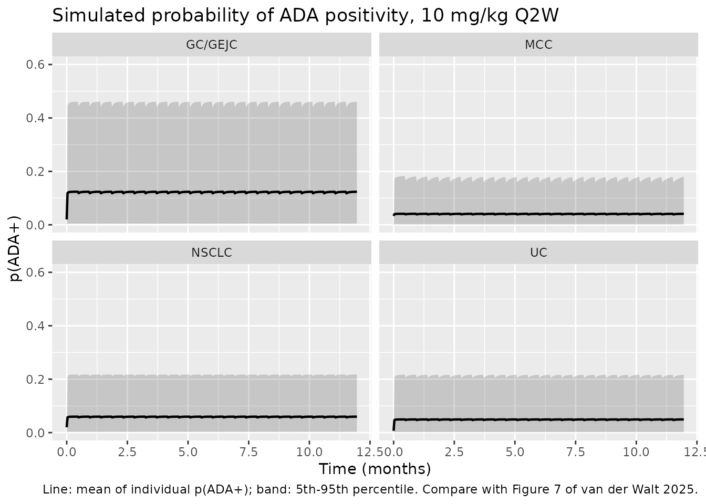
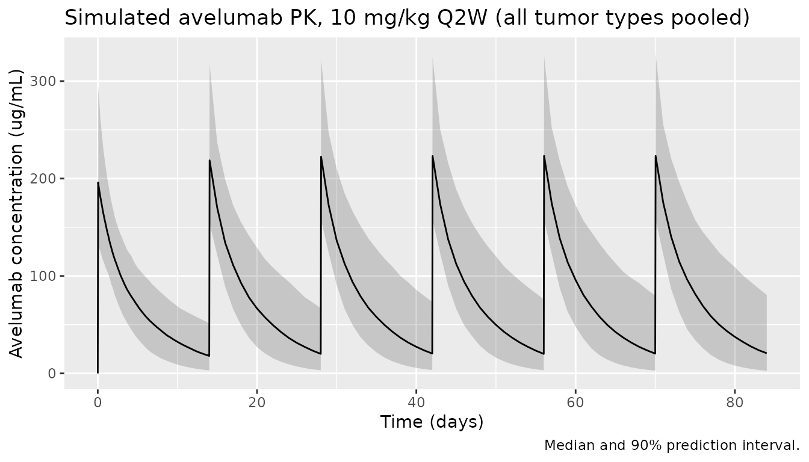

# Avelumab joint PK-ADA model (van der Walt 2025)

## Model and source

- Citation: van der Walt JS, Wilkins J, Khandelwal A, Venkatakrishnan K,
  Gao W, Milenkovic-Grisic AM. Interplay between pharmacokinetics and
  immunogenicity of therapeutic proteins: stepwise development of a
  bidirectional joint pharmacokinetics-anti-drug antibodies model. J
  Pharmacokinet Pharmacodyn. 2025;52(3):33.
  <doi:10.1007/s10928-025-09971-w>
- Description: Bidirectional joint PK-ADA model for avelumab (anti-PD-L1
  IgG1) in adults with solid tumors: two-compartment PK with sigmoid
  time-varying clearance, linked to a two-state continuous-time Markov
  model of anti-drug-antibody (ADA) status in which the probability of
  ADA positivity raises clearance and avelumab concentration lowers the
  ADA-negative to ADA-positive transition rate (van der Walt 2025)
- Article: <https://doi.org/10.1007/s10928-025-09971-w> (open access,
  PMC12095442)

van der Walt et al. built the model in steps: avelumab population PK
with anti-drug-antibody (ADA) status as a covariate, then discrete-time
and continuous-time Markov models (DTMM, CTMM) of ADA status, then a
joint PK-CTMM. The packaged model is the final joint model, Table 5
column “ADA on CL + C1 on ADA” (the lowest objective function value,
-120.1 points against the unlinked joint base model). It links the two
parts in both directions:

- the probability of being ADA-positive, `p(ADA+)`, raises avelumab
  clearance linearly (`CL x (1 + 0.15 p(ADA+))`), and
- the avelumab concentration in the central compartment lowers the
  ADA-negative to ADA-positive transition rate constant `lambda01`
  through a sigmoid Emax function (maximum -37.4%, EC50 349 ug/mL, shape
  2.58).

The PK part is the two-compartment model of Wilkins et al. (2019) with a
sigmoid time-dependent change in clearance, reduced to body weight as
the only covariate. Tumor type and baseline ADA status act on
`lambda01`.

## Population

Pooled data from seven avelumab trials (paper Table 1): JAVELIN Solid
Tumor (second-line urothelial carcinoma cohorts), Solid Tumor JPN
(Japanese patients, including a gastric expansion), Merkel 200
(second-line Merkel cell carcinoma), Lung 200 (second-line NSCLC), Lung
100 (first-line NSCLC), Gastric 100 (first-line maintenance gastric /
gastroesophageal junction cancer) and Gastric 300 (third-line gastric /
GEJ cancer). Of 1892 patients with evaluable PK, 1513 (about 80%,
stratified by ever-ADA-positive status) formed the model-development set
and 379 the external-validation set. Dosing was 10 mg/kg IV every 2
weeks in most studies (3 and 20 mg/kg in the Japanese phase I; 10 mg/kg
weekly for 12 weeks then every 2 weeks in one Lung 100 arm). Between
5.7% and 15.3% of patients per study were ADA-positive at least once.
The paper does not tabulate age, weight or sex.

``` r

str(rxode2::rxode(readModelDb("vanderWalt_2025_avelumab"))$population)
#> ℹ parameter labels from comments will be replaced by 'label()'
#> List of 10
#>  $ species      : chr "human"
#>  $ n_subjects   : int 1513
#>  $ n_studies    : int 7
#>  $ age_range    : chr "adults (not tabulated)"
#>  $ weight_range : chr "not reported"
#>  $ disease_state: chr "Advanced or metastatic solid tumors: NSCLC (1L and 2L), gastric / gastroesophageal junction cancer (1L maintena"| __truncated__
#>  $ dose_range   : chr "3, 10 or 20 mg/kg IV every 2 weeks; 10 mg/kg weekly for 12 weeks then every 2 weeks (JAVELIN Lung 100)"
#>  $ regions      : chr "Global (multinational phase I-III trials, including a Japanese phase I study)"
#>  $ ada_incidence: chr "5.7-15.3% of patients ADA-positive at least once, by study (Table 1)"
#>  $ notes        : chr "Model development subset (1513 of 1892 patients, about 80%, stratified by ever-ADA-positive status); 379 patien"| __truncated__
```

## Source trace

Every `ini()` value carries an in-file comment naming its source. In
summary:

| Element | Value | Source |
|----|----|----|
| CL (no ADA, time zero, 70 kg) | 0.0275 L/h | Table 5, column “ADA on CL + C1 on ADA” |
| V1, V2, Q | 3.52 L, 0.582 L, 0.0128 L/h (fixed) | Table 5 |
| Allometric exponents CL, V1, V2, Q | 0.75, 1, 1, 0.75 (fixed) | Supplementary Table 7 |
| Imax, T50, gamma of time-dependent CL | -0.015, 51.9 days, 2.59 (fixed) | Table 5; equation in Methods “Avelumab population PK model” |
| lambda01, lambda10 | 0.00406 /h, 0.146 /h (fixed) | Table 5 |
| Tumor type on lambda01 (GC/GEJC, UC, MCC, other) | 1.17, -0.404, -0.373, -0.99 (fixed) | Table 5 (Table 4 final CTMM) |
| Baseline ADA+ on lambda01 | 4.38 (fixed) | Table 5 row “Baseline ADA+: change in K34” |
| Slope of p(ADA+) on CL | 0.15 | Table 5; Results (“15.0% … bi-directional”) |
| Exposure on lambda01: Emax, EC50, shape | -0.374, 349 ug/mL, 2.58 | Table 5; Results |
| IIV CL, V1, lambda01 | 39.9%, 24.6%, 329% | Table 5 |
| IIV Imax (additive) | 21.8% (fixed) | Table 5 row “IIV on TMAX”; Methods “additively” |
| Residual error PK | 21.1% proportional, 2378.6 ng/mL additive (fixed) | Table 5 |
| CTMM ODEs | `dA0/dt = -lambda01 A0 + lambda10 A1` | Methods, “Continuous-time Markov models” |
| Elimination | `k10 = CL/V1 x P1eff x exp(Timeeff + etaCL)` | Methods, “Joint PK-ADA model” |
| Categorical covariate form | `PAR x (1 + theta)` | Methods, “Covariate model” |

## Typical-value checks

The ADA chain equilibrates fast: its time constant is
`1 / (lambda01 + lambda10)`, about 6.7 h. Within a day of the start of
treatment `p(ADA+)` therefore sits at its quasi-stationary value
`lambda01 / (lambda01 + lambda10)`, which moves only as the avelumab
concentration changes `lambda01`. The first check solves the model for a
typical 70 kg patient with no drug and compares `p(ADA+)` after 3 days
with that closed form, for every tumor type and both baseline ADA
states.

``` r

mod <- readModelDb("vanderWalt_2025_avelumab")
mod_typ <- rxode2::zeroRe(mod)
#> ℹ parameter labels from comments will be replaced by 'label()'
th <- rxode2::rxode(mod)$theta
#> ℹ parameter labels from comments will be replaced by 'label()'

tumor_levels <- c("NSCLC", "GC/GEJC", "UC", "MCC", "Other")
tumor_cols <- function(tumor) {
  data.frame(
    TUMTP_GASTRIC = as.integer(tumor == "GC/GEJC"),
    TUMTP_BLADDER = as.integer(tumor == "UC"),
    TUMTP_MCC = as.integer(tumor == "MCC"),
    TUMTP_OTHER = as.integer(tumor == "Other")
  )
}

grid_typ <- tidyr::crossing(
  tumor = tumor_levels,
  ADA_POS_BASE = c(0L, 1L)
) |>
  mutate(id = dplyr::row_number())
grid_typ <- bind_cols(grid_typ, tumor_cols(grid_typ$tumor))

ev_typ <- grid_typ |>
  tidyr::crossing(time = c(0, 72)) |>
  mutate(evid = 0L, amt = 0, cmt = "central", dvid = 1L, WT = 70) |>
  arrange(id, time) |>
  as.data.frame()

# Ten typical-value subjects on purpose; rxode2 warns that a multi-subject
# solve has no omega, which is expected after zeroRe().
sim_typ <- suppressWarnings(rxode2::rxSolve(
  mod_typ, ev_typ,
  keep = c("tumor"), returnType = "data.frame"
))
#> ℹ omega/sigma items treated as zero: 'etalcl', 'etalvc', 'etallambda01', 'etacl_time_max'

lambda10 <- exp(th[["llambda10"]])
chk_typ <- sim_typ |>
  filter(time == 72) |>
  mutate(
    lambda01_cf = exp(th[["llambda01"]]) *
      (1 + th[["e_ada_pos_base_lambda01"]] * ADA_POS_BASE) *
      (1 + th[["e_tumtp_gastric_lambda01"]] * TUMTP_GASTRIC) *
      (1 + th[["e_tumtp_bladder_lambda01"]] * TUMTP_BLADDER) *
      (1 + th[["e_tumtp_mcc_lambda01"]] * TUMTP_MCC) *
      (1 + th[["e_tumtp_other_lambda01"]] * TUMTP_OTHER),
    p_cf = lambda01_cf / (lambda01_cf + lambda10)
  )

chk_typ |>
  transmute(
    tumor, ADA_POS_BASE,
    `lambda01 (1/h)` = signif(lambda01, 3),
    `p(ADA+) model, day 3` = signif(p_adapos, 4),
    `p(ADA+) closed form` = signif(p_cf, 4)
  ) |>
  knitr::kable(caption = "Quasi-stationary p(ADA+) for a typical patient with no drug.")
```

| tumor   | ADA_POS_BASE | lambda01 (1/h) | p(ADA+) model, day 3 | p(ADA+) closed form |
|:--------|-------------:|---------------:|---------------------:|--------------------:|
| GC/GEJC |            0 |       8.81e-03 |             0.056910 |            0.056910 |
| GC/GEJC |            1 |       4.74e-02 |             0.245100 |            0.245100 |
| MCC     |            0 |       2.55e-03 |             0.017140 |            0.017140 |
| MCC     |            1 |       1.37e-02 |             0.085770 |            0.085760 |
| NSCLC   |            0 |       4.06e-03 |             0.027060 |            0.027060 |
| NSCLC   |            1 |       2.18e-02 |             0.130100 |            0.130100 |
| Other   |            0 |       4.06e-05 |             0.000278 |            0.000278 |
| Other   |            1 |       2.18e-04 |             0.001521 |            0.001494 |
| UC      |            0 |       2.42e-03 |             0.016300 |            0.016300 |
| UC      |            1 |       1.30e-02 |             0.081880 |            0.081870 |

Quasi-stationary p(ADA+) for a typical patient with no drug. {.table
style="width:100%;"}

``` r


# Same parameters on both sides: the only difference is ODE solver error
# and the residual of the 72 h approach to equilibrium (exp(-72/6.7) ~ 2e-5).
stopifnot(all(abs(chk_typ$p_adapos - chk_typ$p_cf) < 1e-4))
```

With no drug, a typical NSCLC patient who is ADA-negative at baseline
has a 2.7% chance of being ADA-positive at any one time; GC/GEJC raises
this to 5.7%, and baseline ADA positivity raises it about 5-fold.

The second check gives a large, slow infusion to drive the concentration
above EC50 and confirms that the drug effect on `lambda01` has the
published direction and size (a decrease, at most 37.4%), and that the
clearance multiplier equals `1 + 0.15 p(ADA+)`.

``` r

ev_link <- data.frame(
  id = 1L, time = c(0, seq(0, 336, by = 2)),
  evid = c(1L, rep(0L, 169)), amt = c(4000, rep(0, 169)),
  dur = c(48, rep(NA, 169)), cmt = "central", dvid = c(NA, rep(1L, 169)),
  WT = 70, ADA_POS_BASE = 0L
) |>
  cbind(tumor_cols("NSCLC"))
sim_link <- rxode2::rxSolve(mod_typ, ev_link, returnType = "data.frame") |>
  filter(Cc > 0)
#> ℹ omega/sigma items treated as zero: 'etalcl', 'etalvc', 'etallambda01', 'etacl_time_max'

emax_cf <- 1 + th[["emax_lambda01"]] * sim_link$Cc^exp(th[["lhill_lambda01"]]) /
  (exp(th[["lec50_lambda01"]])^exp(th[["lhill_lambda01"]]) +
    sim_link$Cc^exp(th[["lhill_lambda01"]]))
stopifnot(
  all(abs(sim_link$conc_lambda01 - emax_cf) < 1e-8),
  all(sim_link$conc_lambda01 <= 1),
  min(sim_link$conc_lambda01) > 1 + th[["emax_lambda01"]],
  all(abs(sim_link$adapos_cl - (1 + 0.15 * sim_link$p_adapos)) < 1e-10)
)
c(
  max_Cc_ugmL = max(sim_link$Cc),
  min_conc_multiplier_on_lambda01 = min(sim_link$conc_lambda01)
)
#>                     max_Cc_ugmL min_conc_multiplier_on_lambda01 
#>                     894.6275095                       0.6562993
```

At the EC50 of 349 ug/mL the multiplier on `lambda01` is
`1 - 0.374 / 2 = 0.813`. The paper notes that this concentration is
above the typical steady-state peak of the 800 mg Q2W regimen, so over
the clinical range the drug effect on ADA formation is modest.

## Virtual cohort and simulation

The paper reports no weight distribution. The cohort draws weight
log-normally around 71 kg (the median body weight of the Wilkins 2019
pooled avelumab analysis that this PK model descends from) with a 22%
CV, truncated to 35-150 kg. Baseline ADA positivity is drawn with
probability 2.12%, the DTMM estimate (Table 3, logit -3.83). Each of the
four named tumor types gets 150 patients on 10 mg/kg Q2W as a 1-hour
infusion for one year.

``` r

set.seed(20250521)
rxode2::rxSetSeed(20250521)
n_per_arm <- 150
tumors_sim <- c("NSCLC", "GC/GEJC", "UC", "MCC")

cohort <- tibble(
  id = seq_len(n_per_arm * length(tumors_sim)),
  tumor = rep(tumors_sim, each = n_per_arm),
  WT = pmin(pmax(rlnorm(n_per_arm * length(tumors_sim), log(71), 0.22), 35), 150),
  ADA_POS_BASE = rbinom(n_per_arm * length(tumors_sim), 1, 0.0212)
) |>
  bind_cols(tumor_cols(rep(tumors_sim, each = n_per_arm)))

dose_times_h <- seq(0, by = 14 * 24, length.out = 26)
# Daily samples for the year, every 4 h over the first dosing interval and
# every 2 h over the steady-state NCA interval (days 126-140), plus the end
# of every 1-hour infusion so that each peak is sampled.
obs_times_h <- sort(unique(c(
  seq(0, 364 * 24, by = 24), seq(0, 14 * 24, by = 4),
  seq(126 * 24, 140 * 24, by = 2), dose_times_h + 1
)))

doses <- cohort |>
  tidyr::crossing(time = dose_times_h) |>
  mutate(evid = 1L, amt = 10 * WT, dur = 1, cmt = "central", dvid = NA_integer_)
obs <- cohort |>
  tidyr::crossing(time = obs_times_h) |>
  mutate(evid = 0L, amt = 0, dur = NA_real_, cmt = "central", dvid = 1L)
ev_pop <- bind_rows(doses, obs) |>
  arrange(id, time, desc(evid)) |>
  as.data.frame()

sim_pop <- rxode2::rxSolve(
  mod, ev_pop,
  keep = c("tumor"), returnType = "data.frame"
)
#> ℹ parameter labels from comments will be replaced by 'label()'
```

## Replication of the ADA time course (Figure 7)

Figure 7 of the paper shows the observed fraction of ADA-positive
samples over time, by tumor type, with the CTMM prediction interval. The
model quantity that corresponds to that fraction is the population mean
of the individual `p(ADA+)`. The figure below shows it with the 5th-95th
percentile band of the individual probabilities.

``` r

ada_summary <- sim_pop |>
  filter(time %% 24 == 0) |>
  mutate(month = time / 24 / (365.25 / 12)) |>
  group_by(tumor, month) |>
  summarise(
    mean_p = mean(p_adapos),
    lo = quantile(p_adapos, 0.05),
    hi = quantile(p_adapos, 0.95),
    .groups = "drop"
  )

ggplot(ada_summary, aes(month, mean_p)) +
  geom_ribbon(aes(ymin = lo, ymax = hi), alpha = 0.2) +
  geom_line(linewidth = 0.8) +
  facet_wrap(~tumor) +
  coord_cartesian(ylim = c(0, 0.6)) +
  labs(
    x = "Time (months)", y = "p(ADA+)",
    title = "Simulated probability of ADA positivity, 10 mg/kg Q2W",
    caption = "Line: mean of individual p(ADA+); band: 5th-95th percentile. Compare with Figure 7 of van der Walt 2025."
  )
```



``` r

prev_tab <- sim_pop |>
  filter(time %in% (c(14, 28, 84, 168, 336) * 24)) |>
  mutate(day = time / 24) |>
  group_by(tumor, day) |>
  summarise(mean_p = mean(p_adapos), .groups = "drop") |>
  tidyr::pivot_wider(names_from = day, values_from = mean_p, names_prefix = "day ")
knitr::kable(prev_tab, digits = 3,
  caption = "Mean simulated p(ADA+) (expected fraction of ADA-positive samples) by tumor type.")
```

| tumor   | day 14 | day 28 | day 84 | day 168 | day 336 |
|:--------|-------:|-------:|-------:|--------:|--------:|
| GC/GEJC |  0.124 |  0.124 |  0.124 |   0.124 |   0.124 |
| MCC     |  0.041 |  0.041 |  0.041 |   0.041 |   0.041 |
| NSCLC   |  0.060 |  0.060 |  0.060 |   0.060 |   0.060 |
| UC      |  0.049 |  0.049 |  0.049 |   0.049 |   0.049 |

Mean simulated p(ADA+) (expected fraction of ADA-positive samples) by
tumor type. {.table}

The observed fractions in Figure 7 run at about 0.05-0.15 for GEJ, about
0.02-0.05 for UC, about 0.02-0.08 for NSCLC and about 0.0-0.05 for MCC
over the first six months. The simulated means sit in the same range and
in the same order (GC/GEJC highest, NSCLC next, UC and MCC lowest). The
late rise of MCC to about 0.4 at month 12 in Figure 7 rests on very few
patients still on study and is not reproduced by a time-homogeneous
chain; the paper’s own CTMM band does not follow it either beyond month
9.

Because the chain equilibrates within hours, the statuses of one patient
at samples two or more weeks apart are, given that patient’s parameters,
independent draws with probability `p(ADA+)`. That gives the expected
fraction of patients found ADA-positive at least once on a study’s ADA
sampling schedule (Table 1) as `1 - prod(1 - p_i(t_j))` per patient.

``` r

schedules <- list(
  "JAVELIN Solid Tumor (UC)" = list(tumor = "UC", days = c(0, 14, 28, 42, 56, 60, 84, 168), obs = 7.6),
  "JAVELIN Merkel 200 (MCC)" = list(tumor = "MCC", days = c(0, 14, 28, 42, 84), obs = 5.7),
  "JAVELIN Lung 200 (NSCLC)" = list(tumor = "NSCLC", days = c(0, 14, 28, 42, 84, 124, 168, 252), obs = 13.0),
  "JAVELIN Gastric 300 (GC/GEJC)" = list(tumor = "GC/GEJC", days = c(0, 14, 28, 42, 84), obs = 9.2)
)
ever_tab <- dplyr::bind_rows(lapply(names(schedules), function(nm) {
  s <- schedules[[nm]]
  sim_pop |>
    filter(tumor == s$tumor, time %in% (s$days * 24)) |>
    group_by(id) |>
    summarise(p_ever = 1 - prod(1 - p_adapos), .groups = "drop") |>
    summarise(simulated = 100 * mean(p_ever)) |>
    mutate(study = nm, observed = s$obs, n_samples = length(s$days))
}))
ever_tab |>
  select(study, n_samples, observed, simulated) |>
  dplyr::rename(
    "Study (Table 1)" = study,
    "ADA samples" = n_samples,
    "Ever ADA+ observed (%)" = observed,
    "Ever ADA+ simulated (%)" = simulated
  ) |>
  knitr::kable(digits = 1,
    caption = "Patients ADA-positive at least once on each study's ADA sampling schedule.")
```

| Study (Table 1) | ADA samples | Ever ADA+ observed (%) | Ever ADA+ simulated (%) |
|:---|---:|---:|---:|
| JAVELIN Solid Tumor (UC) | 8 | 7.6 | 22.9 |
| JAVELIN Merkel 200 (MCC) | 5 | 5.7 | 16.2 |
| JAVELIN Lung 200 (NSCLC) | 8 | 13.0 | 28.6 |
| JAVELIN Gastric 300 (GC/GEJC) | 5 | 9.2 | 34.2 |

Patients ADA-positive at least once on each study’s ADA sampling
schedule. {.table}

The model over-predicts the fraction of patients ever found
ADA-positive, by about 2- to 4-fold. Early discontinuation explains part
of the gap for the longer schedules (the simulation keeps every patient
on study for every sample), but the short Gastric 300 and Merkel 200
schedules are over-predicted as well. The reason is structural. With the
published rate constants an ADA-positive episode lasts on average
`1 / lambda10`, about 7 hours, so a patient’s statuses at visits two
weeks apart are independent draws. In the trials, ADA positivity was
concentrated in fewer patients and persisted across visits. The large
IIV on `lambda01` captures part of that clustering, but not all of it.
The model was fit to each sample given the status observed at the
previous one, and that conditioning has decayed within a day at these
rates. The model therefore reproduces the sample-level prevalence it was
fit to (above), not the patient-level persistence. The values here are
from the paper and were not adjusted.

## Avelumab PK

### Concentration-time profile

``` r

pk_summary <- sim_pop |>
  filter(time <= 84 * 24) |>
  group_by(time) |>
  summarise(
    median = median(Cc), lo = quantile(Cc, 0.05), hi = quantile(Cc, 0.95),
    .groups = "drop"
  )
ggplot(pk_summary, aes(time / 24, median)) +
  geom_ribbon(aes(ymin = lo, ymax = hi), alpha = 0.2) +
  geom_line() +
  labs(
    x = "Time (days)", y = "Avelumab concentration (ug/mL)",
    title = "Simulated avelumab PK, 10 mg/kg Q2W (all tumor types pooled)",
    caption = "Median and 90% prediction interval."
  )
```



### Effect of ADA on clearance

The bidirectional model attributes at most a 15% clearance increase to
ADA (at `p(ADA+) = 1`). Over the simulated year the individual clearance
multiplier `1 + 0.15 p(ADA+)` is distributed as follows.

``` r

sim_pop |>
  filter(time == 168 * 24) |>
  group_by(tumor) |>
  summarise(
    median = median(adapos_cl),
    p90 = quantile(adapos_cl, 0.9),
    max = max(adapos_cl),
    .groups = "drop"
  ) |>
  knitr::kable(digits = 3,
    caption = "Clearance multiplier due to ADA at day 168.")
```

| tumor   | median |   p90 |   max |
|:--------|-------:|------:|------:|
| GC/GEJC |  1.011 | 1.050 | 1.092 |
| MCC     |  1.002 | 1.015 | 1.080 |
| NSCLC   |  1.004 | 1.022 | 1.077 |
| UC      |  1.003 | 1.017 | 1.064 |

Clearance multiplier due to ADA at day 168. {.table}

### NCA

The paper reports no NCA. It does quote, from the avelumab label
analysis, a geometric-mean steady-state Cmax of 256.3 ug/mL for the
approved 800 mg Q2W flat dose. A second cohort of 150 NSCLC patients on
800 mg Q2W provides the matching simulated value; the NCA runs on the
10th dosing interval (days 126-140), by which time the 2-week
accumulation is complete. The 10 mg/kg Q2W cohort is analysed on the
same interval for comparison.

``` r

cohort_flat <- cohort |>
  filter(tumor == "NSCLC") |>
  mutate(id = id + 10000L)
ev_flat <- bind_rows(
  cohort_flat |> tidyr::crossing(time = dose_times_h) |>
    mutate(evid = 1L, amt = 800, dur = 1, cmt = "central", dvid = NA_integer_),
  cohort_flat |> tidyr::crossing(time = obs_times_h) |>
    mutate(evid = 0L, amt = 0, dur = NA_real_, cmt = "central", dvid = 1L)
) |>
  arrange(id, time, desc(evid)) |>
  as.data.frame()
sim_flat <- rxode2::rxSolve(mod, ev_flat, keep = c("tumor"), returnType = "data.frame")

int_start <- 126 * 24
int_end <- 140 * 24
nca_in <- bind_rows(
  sim_pop |> mutate(treatment = "10 mg/kg Q2W"),
  sim_flat |> mutate(treatment = "800 mg Q2W")
) |>
  filter(!is.na(Cc), time >= int_start, time <= int_end) |>
  mutate(time_rel = time - int_start) |>
  select(id, treatment, time_rel, Cc)

dose_in <- bind_rows(
  cohort |> mutate(treatment = "10 mg/kg Q2W", amt = 10 * WT),
  cohort_flat |> mutate(treatment = "800 mg Q2W", amt = 800)
) |>
  mutate(time_rel = 0) |>
  select(id, treatment, time_rel, amt)

conc_obj <- PKNCA::PKNCAconc(nca_in, Cc ~ time_rel | treatment + id)
dose_obj <- PKNCA::PKNCAdose(dose_in, amt ~ time_rel | treatment + id)
intervals <- data.frame(start = 0, end = 14 * 24, cmax = TRUE, cmin = TRUE, auclast = TRUE)
nca_res <- PKNCA::pk.nca(PKNCA::PKNCAdata(conc_obj, dose_obj, intervals = intervals))
knitr::kable(summary(nca_res), caption = "Simulated steady-state NCA (days 126-140).")
```

| start | end | treatment    | N   | auclast        | cmax         | cmin         |
|------:|----:|:-------------|:----|:---------------|:-------------|:-------------|
|     0 | 336 | 10 mg/kg Q2W | 600 | 26000 \[45.0\] | 227 \[23.6\] | 18.3 \[159\] |
|     0 | 336 | 800 mg Q2W   | 150 | 29600 \[50.4\] | 261 \[28.9\] | 20.1 \[199\] |

Simulated steady-state NCA (days 126-140). {.table}

``` r


reference <- data.frame(treatment = "800 mg Q2W", cmax = 256.3)
nlmixr2lib::ncaComparisonTable(
  simulated = nca_res,
  reference = reference,
  by = "treatment",
  params = "cmax",
  units = c(cmax = "ug/mL")
) |>
  knitr::kable(caption = "Steady-state Cmax, 800 mg Q2W: simulated median vs the geometric mean quoted in the paper.")
```

| NCA parameter | treatment  | Reference | Simulated | % diff |
|:--------------|:-----------|:----------|:----------|:-------|
| Cmax (ug/mL)  | 800 mg Q2W | 256       | 260       | +1.3%  |

Steady-state Cmax, 800 mg Q2W: simulated median vs the geometric mean
quoted in the paper. {.table}

The comparison is a plausibility check only: the 256.3 ug/mL figure
comes from a different analysis (cited by the paper), and the simulated
cohort uses an assumed weight distribution and the joint model’s reduced
PK covariate set.

## Assumptions and deviations

- **Direction of the exposure effect on `lambda01`.** The Methods print
  `lambda01 = exp(C1eff x log(theta) + eta)`. Taken literally, with
  `log(theta)` negative, a `C1eff` below 1 makes `lambda01` larger
  (about 8-fold at high concentration with Emax -0.374), which
  contradicts the abstract, Results, Discussion and Conclusions (“a
  decrease in ADA- to ADA+ transition rate of up to 37% with increasing
  avelumab concentration”) and the stated -100% to 500% bound on the
  change. The model uses `lambda01 = theta x C1eff x exp(eta)`, i.e.
  `exp(log(C1eff x theta) + eta)`, which reproduces the published 37%
  maximal decrease.
- **Categorical effects on `lambda01`.** The packaged model uses the
  paper’s printed categorical form `PAR x (1 + theta)`. That makes
  `lambda01` 2.17-fold for GC/GEJC and 5.38-fold for baseline ADA+,
  whereas the Results text calls these “17% higher” and “3.8-fold
  higher”. The printed form is kept because it reproduces the paper’s
  DTMM numbers (Table 3 logit -5.05 x (1 - 0.215) gives p01 = 1.87%, the
  reported 1.8% for GC/GEJC) and the roughly two-fold GEJ vs NSCLC
  difference in Figure 7.
- **IIV percentages.** Table 5 percentages are read as the log-normal
  CV, `omega^2 = log(1 + CV^2)`: CL 0.148, V1 0.0588, `lambda01` 2.47.
  Reading 329% as an SD instead (`omega^2 = 10.8`) would raise the mean
  simulated p(ADA+) well above the Figure 7 fractions. The IIV on Imax
  is additive (Methods; the Wilkins 2019 control stream codes
  `TMAX = TVTMAX + ETA(4)`), so 21.8% is used as an SD of 0.218 on Imax.
- **`cl_time_max` is not log-transformed.** Imax is a signed shift on
  log-clearance with an additive random effect, so it is kept on its
  natural scale (as in `Zhang_2019b_nivolumab`). The convention
  checker’s “should be log-transformed” warning for this parameter is
  expected.
- **Time units of T50.** Table 5 gives T50 = 51.9 days and the Wilkins
  2019 control stream divides time in hours by 24 before applying T50,
  so T50 is used in days. The Discussion’s “around 12 months” for the
  time to 50% of the maximal change in clearance does not match this
  value; it is not used.
- **Reference weight.** The paper uses “standard allometry coefficients”
  but does not state the reference weight; 70 kg is used. (Wilkins 2019
  normalised to its 71 kg median; the difference is under 1% on CL.)
- **CL-`lambda01` correlation.** The Methods and Discussion say the
  joint model estimated a correlation between the random effects on CL
  and `lambda01`, but no value is printed for the final model; it is
  omitted.
- **Tables 2 vs 5.** Table 2 lists a 14.9% ADA effect on CL for the
  mono-directional and 11.6% for the bi-directional model; Table 5
  (slope 0.116 vs 0.15), the Results text and the abstract (15%) have
  the reverse. Table 5 is used.
- **Observed ADA status** is encoded as the binary endpoint
  `ada_status ~ c(p0_ada)` (category 1 ADA-negative, 2 ADA-positive),
  matching the Bernoulli likelihood of the paper. The NONMEM fit reset
  the chain to the observed status after every ADA sample; a simulation
  from the packaged model gives the marginal probability given the
  baseline status, which (because the chain equilibrates within hours)
  is practically the same as the conditional one at the trials’ two-week
  or longer sampling intervals.
- **Infusion duration** (1 hour) and the **weight distribution** of the
  virtual cohort are not reported in the paper and are assumptions of
  this vignette only.
- **Tumor-type covariates.** “Other solid tumors” (`TUMTP_OTHER`, effect
  -0.99 fixed) had no ADA-positive patient in the development set and is
  not simulated here.
